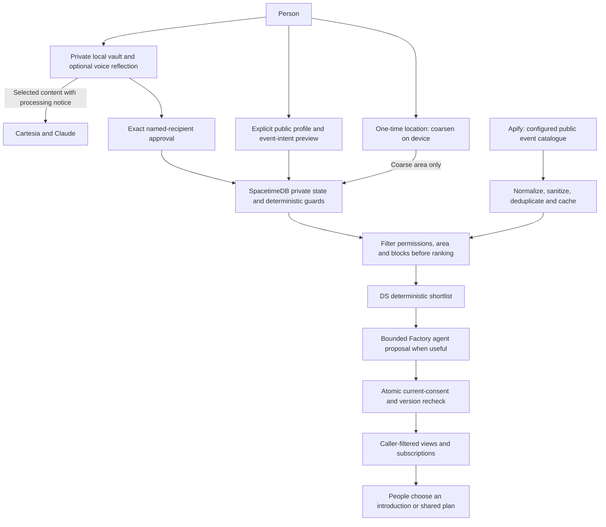

# Expanded product and implementation guide

This file holds the detailed product model, ownership, phased implementation, architecture, privacy, efficiency targets and verification guidance moved out of README.md. For the current implementation and deployment ledger, use [PROJECT_KNOWLEDGE.md](PROJECT_KNOWLEDGE.md); historical status snapshots below are not more authoritative than that ledger. Agent entry and day-to-day operating rules remain in [AGENTS.md](AGENTS.md).

---

# dor

### AI that helps people build connection through life's transitions

When someone starts college, moves to a new city, begins a job or graduates, dor helps them build a human support network. New connections and local activities are the main path. Maintaining or rekindling existing relationships is a complementary path through the same transition. The product is for making real human connection easier, not replacing it with a better chatbot.

> Choose a new chapter → discover people and real things to do → make the first human connection.

## Current direction — transition-first connection discovery (2026-10-24)

**D045 product decision:** the central user problem is rebuilding a support network during life transitions. New local connections are core; reconnecting with an old friend is one useful case, not the whole product. Apify's generic public event catalogue is also a core discovery input. This updates product priority only: it does not silently authorize new C7/C8 fields or bypass the contract review gates. Preserve existing implementation and consent boundaries.

**Core journey:** choose a transition and broad area → separately opt in to selected profile fields → see eligible public profiles and source-backed activities → choose a reason to connect → send an in-app introduction → recipient accepts or declines → optionally agree on a shared activity. Voice journaling is optional and is not required to discover people. Existing relationship reflection/nudges remain available as a supporting path.

**Apify boundary:** ingest one generic, developer-configured local events feed on a bounded schedule, normalize/cache it, and match it inside dor. Never send journal text, private quiz answers, profile/pair IDs, attendance intentions, personal interests or a device-derived location to an Actor. Do not expose scraped attendees; event listings are not attendance evidence. Candidate Actor selection requires checking actual coverage, output schema, maintenance, terms and capped cost first.

**Current existing-connection decision — D050:** accepted pairs use automatic in-app nudges under the current relationship preset. The recipient can opt out per connection; quiet hours, pauses, cooldown and server checks remain. The owner does not approve each nudge or configure a standing rule. A private conflict or urgent-support assessment suppresses the reflection's nudge path; urgent support shows resources and never contacts a connection. See [Automatic nudges](docs/features/AUTOMATIC_NUDGES.md).

**D050 data boundary:** only an on-device unique match may resolve a mentioned person. The backend receives only the pair ID and allowed enum signal; neither journal nor private assessment enters peer-agent state. Conflict and urgent-support flags suppress the workflow. The recipient's per-connection opt-out and server policy remain authoritative.

### Sponsor targets and implementation evidence

Source: user-supplied **13.0 Hacker Guide.pdf**, PDF pages 11–13 (printed pages 10–12), and the [official prize listing](https://cal-hacks-13-0.devpost.com/). The guide says detailed criteria are on the [live site](https://hive.hackberkeley.org/prizes) and prizes may change. Tool use below is **our implementation/evidence requirement**, not an invented complete sponsor rubric. Credits, installed packages and a sponsor logo do not prove eligibility.

| Target / priority | Required tool contribution in dor | Owner and evidence before claiming readiness |
|---|---|---|
| **Meta/Facebook: Bringing People Closer Together with AI — primary product target** | Demonstrate AI helping people form human connections during transitions: public opted-in profiles, relevant local activities, and a safe, recipient-controlled introduction. Existing partner/friend/family reconnection remains a supporting example. The supplied guide does not specify a required Meta model/API; do not assume Llama, WhatsApp or Meta hardware is mandatory. | **All; CS integrates, Nimisha evaluates.** Show a newcomer finding a real activity/person and choosing to connect, a recipient-controlled acceptance, and a truthful no-fit/unsafe suppression case. Confirm any additional technical/submission conditions with the sponsor. |
| **Anthropic: Best use of Claude — primary** | Claude may interpret an allowed shortlist and help produce a constrained, low-pressure suggestion. It cannot discover hidden candidates, determine eligibility, grant consent, or author a message sent as the user. Private reflection stays a separate opt-in existing-connection path. | **Adam + Nimisha; Sumedh reviews the boundary.** User confirmed the challenge title; the guide still says “Coming soon.” Record real Claude execution, constrained outputs and positive/clarify/no-action cases. Coding with Claude alone is not the product integration we intend to demonstrate. |
| **Factory: Best Use of the Factory Droid SDK — primary, rework in progress** | Rework orchestration to use the actual **Droid SDK** for an application-triggered, bounded workflow over approved signals. Preserve tool restrictions, isolated execution, cancellation, call limits and commit-time policy checks. | **Adam; CS supplies runtime/configuration.** **SDK call path (AI PR, offline-tested, isolated live run):**
- The worker's default transport is `worker/src/droid-sdk.ts`. It uses `createSession`/`session.stream` from `@factory/droid-sdk@0.10.0`, with one locked-down session per prompt.
- `droid exec` remains only as the explicit `DOR_DROID_TRANSPORT=cli` fallback and must not be presented as the SDK integration.
- Live evidence so far uses synthetic stand-ins, not the deployed worker/database: 4/4 cases decided via the SDK. Reproduce with `node worker/scripts/live-droid.mjs --runs 1` (spends Factory credits).
- Deployed end-to-end evidence and final eligibility with Factory remain open. [SDK docs](https://docs.factory.com/sdk/typescript). |
| **Cartesia: Best Use of Cartesia — primary** | Voice is an optional way to reflect or capture transition context; it must not gate discovery. Use short-lived browser tokens, provider-processing copy and typed fallback. | **Adam; CS composes the UI.** Demonstrate record/stop/correct, typed fallback, denied microphone, cancellation and token expiry. A saved API key or mocked audio does not establish a working integration. |
| **SpacetimeDB — core infrastructure; exact challenge title/criteria pending** | Authoritative reducers, private tables, caller-filtered views and live subscriptions for pairs, exact approvals, recipient consent, nudges and revocation. CLI publishing/generation is tooling, not the runtime integration. | **CS + Sumedh.** Two signed-in accounts and a denied third account; revocation during generation; retry without duplicate delivery. Guide lists “Coming soon”; [Spacetime's announcement](https://spacetimedb.com/blog/spacetime-at-calhacks) confirms a usage prize without a complete rubric. Record the exact submission category when confirmed. |
| **Apify: Best use of Apify — core integration target** | A real server-side Actor/API public activity source, normalized and cached with provenance; matching stays in dor. Keep personal context, recipient IDs and user-derived location out of Actor input. | **CS; Nimisha ranks permitted results, Sumedh reviews inputs.** Source/Actor pairs and pinned-build enforcement are configured in code; a capped live sample, source terms/maintenance review, Cyber input review and owner-approved spend remain open. A fixture is not a live integration. The separate Best Actor category is not claimed merely for consuming an existing Actor. |

No extra tool is being added solely to chase another prize. Sponsor evidence should contain code paths, reproducible synthetic-data demos and content-free usage metrics, never keys, raw journals or private clarification answers. Video/presentation planning remains in [docs/DEMO.md](docs/DEMO.md).

### Reasoning layer and human-in-the-loop behavior

**Status:** D050 is implemented on this branch and offline-verified; PR pending, not live-verified. It supersedes older manual-preview and standing-consent product text below. D044 backend remains for compatibility, but the active app path does not require it.

**The rules below stay normative.** Existing presets remain category ceilings; recipient opt-out and private risk flags can only narrow the nudge path. D050 does not widen what journal data is disclosed.

1. **Private understanding (Claude):** process only owner-selected text under the provider notice. Return literal mentioned names, a coarse candidate and `risk: none | interpersonal_conflict | urgent_support`. Risk and names remain in memory on the writer's device. Never compare different people's journals or pass the private assessment to either peer agent.
2. **Name resolution:** one literal name matching exactly one accepted connection on-device starts the two-agent flow automatically. Multiple, ambiguous or unmatched names prompt the owner to choose. If none is named, do nothing. A mention never permits a journal detail or explanation to leave the device.
3. **Safety stop:** `interpersonal_conflict` includes a lie, declined invitation followed by another plan, withheld activity, or likely friction. Suppress the reflection's entire nudge path and reveal no reason. `urgent_support` includes serious mental-health distress such as depression, hopelessness, self-harm thoughts or danger. Show support resources immediately and never contact friends or family. A browser-local keyword fallback can add this classification; it is not a diagnosis and may show resources for quoted or negated terms. Current card is U.S. 988; localization is future work. Missing, malformed or failed assessments suppress nudges.
4. **Two-agent decision:** only the allowed enum signal and pair context reach the agent workflow. The agents may decide no nudge based on valid relationship state, pause, cooldown and support preferences. The agents cannot select a different recipient, add facts from the journal, or send a personal message as the user.
5. **Default authorization:** accepted pairs use the current relationship preset and default-on in-app nudge types. The recipient can opt out per connection; no standing-consent setup or per-nudge sender approval is required. Server rechecks membership, current preset/assignment, allowlisted category, recipient opt-out, pause, quiet hours, cooldown, expiry and revocation at commit/delivery. No automatic path bypasses these controls.
6. **Private clarification:** ask only when identity or intent is unclear; keep questions neutral and owner-only. Do not imply someone has been notified or expose another person's state. Skip, timeout or unresolved ambiguity means no action.
7. **Data handling:** never place journal text, transcript, names, risk, private assessment or conflict reasons in SpacetimeDB, shared agent prompts, analytics, logs, team updates or peer-visible copy. The reflection may be saved only in the local encrypted vault.

**Private-event acceptance case:** someone declines a friend's invitation saying they are sick, later attends a party, and mentions it privately. Mark interpersonal-conflict risk, suppress the reflection's nudge flow, and do not tell the friend why. No “ask about Friday,” event hint, whereabouts, contradiction alert or hidden-story explanation may reach them. Never fabricate a cover story.

**Data lifetime:** keep clarification questions/answers and pending assessments in the owner's current session by default; discard on completion, cancellation, lock or account change. Persistence needs a reviewed local-vault design. Neither raw answers nor reasons belong in SpacetimeDB, analytics, Factory coordination sessions or team logs. Minimal content-free decision codes are enough for synthetic evaluation.

### Core product requirements — coverage and acceptance

These are the actionable conclusions governing this release, not a transcript of external feedback. They are requirements for the next implementation work, not claims of completed protections. **Adam already owns the Droid SDK rework; other agents must not duplicate or replace that work.**

| Conclusion | Required behavior | Acceptance evidence / owner |
|---|---|---|
| Transitions are the core use case | Help someone entering a campus, city, or workplace build new connections through opted-in profiles and concrete local activities. Reconnecting with existing friends/family is a supporting transition path. This is not a clinical mental-health product. | **All:** a new user can discover a real source-backed opportunity and deliberately invite someone; a journal is optional. Nimisha measures useful/no-fit outcomes, not loneliness reduction. |
| Connection is person-specific | Wanting company, having free time, or seeing other friends does not imply wanting to see this friend. Interpret negative and uncertain recipient intent before offering a share preview. Never generalize one person's permission to all friends or everyone on the same preset. | **Nimisha + Adam:** paired fixtures with identical general availability but different recipient intent yield different eligibility; **Sumedh:** excluded recipient cannot be approved or delivered to. |
| Indirect disclosure counts | A question, timing choice, notification title, badge, receipt or explanation must not hint at an unapproved party, activity, location, excuse or interpersonal tension. Safe-looking wording alone is insufficient if its topic or timing reveals the hidden story. | **Sumedh + CS:** inspect every recipient-visible surface; **Nimisha:** hold approved inputs/delivery settings constant while varying the private story and check that recipient-visible content and scheduling do not change. |
| Reasoning must know when to abstain | A unique literal person mention can start the paired-agent decision; uncertainty, conflict, or serious distress can stop it. A confidence score never overrides a boundary. | **Adam + Nimisha:** paired positives, ambiguous names, private-party conflict and urgent-support cases; malformed outputs suppress nudges. |
| Clarification is private and neutral | Ask about the owner's wishes, not whether the software should tip off a friend. Do not mention a queued nudge or imply another person requested information. Do not use leading questions to steer toward delivery. The product still explains that private suggestions may later be shared only with approval. | **CS + Nimisha:** “Would you prefer some space from this person for now?” is acceptable; “Should I tell them to ask about your Friday night?” is not. User can skip or stop without any outbound effect. |
| Clarification resolves ambiguity, not boundaries | A clear unique mention proceeds automatically; multiple or unresolved names ask the owner. A conflict or urgent-support flag suppresses this reflection. | **Adam + CS:** test exact/ambiguous names, dismiss, timeout, explicit space, and risk flags; ensure no old candidate retries. |
| Temporary boundaries are respected | Offer explicit episode-only exclusion or a clearly scoped pause. Show who is paused and the duration to the owner only; never require the user to justify it. A later answer or expired pause must not resurrect an old candidate or queued job. | **Sumedh + CS:** pause invalidates pending work; resume/expiry never replays an old candidate. A genuinely new candidate must pass current D050 pair/preset/opt-out checks. Leaving one person out must not notify them or automatically choose someone else. |
| Success means more human connection, not more AI use | Support new connections during transitions and make existing relationships easier to sustain. A correct no-match or no-nudge is a valid result. Do not promise to reduce loneliness, treat a mental-health condition, or guarantee zero relationship friction. | **Nimisha:** report useful introductions, no-fit, false matches, consent failures and appropriate abstentions separately; disclose synthetic sample size and gather human feedback. |

**Reasoning examples to implement and evaluate:**

- **Positive unique mention:** “I would like a short call with Sam.” Match Sam on-device, then let both agents decide whether an in-app nudge is timely. Sender does not approve each item; recipient opt-out and server checks still apply.
- **Explicit exclusion:** “I want company, but not Alex tonight.” Exclude Alex without requesting a reason. Do not automatically reroute to another person; any other recipient must be uniquely selected and covered by their own current authorization.
- **Uncertain:** “I miss them, but I am not sure I want to talk tonight.” Ask one neutral private question. Skipping means no action, not an optimistic fallback.
- **Private-party scenario:** a private account of attending a party after declining a friend's invitation marks conflict risk and suppresses the whole nudge path. No Friday-night question, activity hint, contradiction alert or reason reaches the friend.
- **Change of mind:** an owner pauses the recipient while generation is underway. Reject the old result at commit and suppress pending derived delivery. An old retry, reconnect, later clarification or pause expiry cannot restore that authorization.

**Implementation boundary:** private risk assessment and name matching happen on-device before any shared coordination. Peer agents receive only the accepted pair and enum payload. Automatic default changes sender review, not the journal disclosure boundary or backend checks. No private journal text or assessment may enter shared agent state. Offline code is not proof of deployed behavior.

### Where implementation actually stands

Inspected repository base for this work: **main cb73d30** (2026-10-24); current unmerged CS changes are on `codex/d044-apify-readme`. Use `PROJECT_KNOWLEDGE.md` and role update logs for latest evidence by branch. Code presence and offline evidence are not deployed proof. A local SpacetimeDB smoke exists on one developer machine with real Clerk dev JWTs; no hosted end-to-end release has been verified.

| Area | Current evidence | Next core work |
|---|---|---|
| Local journal / voice / privacy | Implemented on main: per-account vault composition, VaultControls, VoiceReflection, saved entries, generated bindings (`npm run bindings:check` plus a CI job guard drift); onboarding resets on vault lock; quiz results become unsaved preset drafts. Offline-verified. | Verify real-browser lifecycle, microphone and configured providers; browser UI path not yet exercised live. |
| Existing-connection automatic nudges | Prior main branch has guarded `approve_signal`, recipient settings, revocation and server-side delivery checks. Existing local smoke does not validate D050. | D050 sends only enum payloads after unique on-device name resolution; accepted-pair default is on, recipient per-pair opt-out remains; conflict risk, pause, preset, quiet-hours and cooldown checks remain. No Maincloud/deploy operation is part of this PR. |
| Guarded coordination | Implemented and offline-verified: consent-bound worker adapters, reducer authorization, caller-filtered views, expiry handling, fixed templates, Droid SDK transport default with a 25 s job budget. **Not verified live:** nudge delivery through the worker/Droid (paid) was not run. | AI: worker reconnect, nickname exclusions, paid Stage C run; verify worker identity and races end to end. |
| Recipient-specific avoidance / clarification | Implemented on main and offline-verified: CS private decision loop (question/skip/answer, 2-question cap, never auto-chooses); D040 assessment only narrows (can veto or skip a question); strict candidate parse (malformed means no action); unnamed or duplicate connection labels and fail-closed exclusion of unnamed connections when the assessment names someone; D041 durable pause (Cyber) with CS controls (Connections pause/resume, Privacy active-pauses list, paused recipients never offered). Pause not yet exercised against a running module; Claude live run not done. | Pause against a running module; live Claude run on synthetic cases (needs key and go-ahead); DS to label the new cases. |
| Transition discovery | Discover UI, area-filtered cards, introduction/event/plan guards and DS rankers exist (offline/synthetic, some paths feature-flagged). | Integrate and verify the complete new-user transition journey; choose and test one real Apify Actor/source. C7/C8 canonical contracts remain review-gated; no claim of live Apify retrieval or hosted discovery. |
| Release readiness | Offline checks documented in role logs. Local live smoke above. Hosted deploy not done. Installable PWA implemented (manifest, icons, static-assets-only service worker; in-app delivery only, no push notifications): builds and serves, not yet checked on a phone. Not verified: browser UI path, Cartesia live, any hosted deploy. | Hosted deploy (owner decision pending); see [RUNBOOK](docs/RUNBOOK.md); no full live completion claim. |

### Immediate transition-first milestones and balanced ownership

Use the proposed phases below to target deployment between 6 and 8 p.m. today. The target is aspirational, not a reason to skip contract, consent, or live verification gates. Detailed sequencing and fallback are in [docs/PLAN.md](docs/PLAN.md). All four owners work in parallel within each phase.

| Gate | CS — you | DS — Nimisha | AI — Adam | Cyber — Sumedh | Exit evidence |
|---|---|---|---|---|---|
| **Phase 0: freeze the transition journey** | Reconcile main/open work, select one demo region and current Discover entry point; claim shared files. | Select one newcomer transition and build small synthetic profiles/events including empty and unsafe cases. | Map real/fake model and voice paths; propose bounded calls; preserve existing worker. | Verify which C7/C8 guards are implemented versus proposed; name blockers. | One exact journey and reviewed claims; no unreviewed schema edits. |
| **Phase 1: source-backed discovery** | Validate one events-only Apify Actor and feed configuration; wire one server-only adapter/cache; compose transition onboarding and Discover. | Implement deterministic eligibility, top results and honest no-fit states. | Keep model optional; zero calls for empty/denied and deterministic one-result cases. | Review exact publication/area/event fields, access controls, expiry and abuse limits. | An opted-in newcomer sees only bounded eligible profiles and source-backed activities; failures are explicit. |
| **Phase 2: make one connection happen** | Wire invite and recipient response to reviewed reducers; show source/freshness and acceptance states. | Evaluate false matches, duplicates, stale events, withdrawn/blocked profile and cold start. | Add bounded suggestion only over approved refs/reasons; never send a personal message. | Reject reducer bypass, stale revisions, invite replay, cross-user reads, and block/withdraw races. | User initiates; recipient accepts or declines; event plan requires both to accept same revision. |
| **Phase 3: transition continuity** | Explain support for new and existing ties; keep the journal optional. | Compare new-connection and reconnect use cases with paired fixtures/quick team ratings. | Keep private reflection and D050 name/risk fields out of discovery and peer-agent prompts. | Verify discovery cannot inherit pair presets or journals; audit default-on nudge and recipient opt-out behavior. | Both paths fit the transition story; discovery works with the vault locked. |
| **Phase 4–5: audit, deploy, recover** | Check catalogue caching, identity/bindings, deploy fixed revision and rollback. | Record actual usefulness/no-fit results and sample limits. | Measure calls/latency/failures if configured; no paid test just for setup. | Test direct access, withdrawal/revocation and output allowlists; verify live third-account denial. | Only verified flows are shown as live; keep a truthful synthetic/source-unavailable fallback. |

Status is split by evidence type below and in PROJECT_KNOWLEDGE. This guide began as a README snapshot from before main `cb73d30`; PROJECT_KNOWLEDGE.md and the latest README entry point are canonical for current status.

**Core definition of done:** a person in one chosen transition can opt into a public profile, see an eligible person and a real public activity, and deliberately start an in-app interaction the recipient may accept or decline. A journal is optional; no account can see another person's private state. Preserve partner/friend/family coverage and verify D050 with recipient opt-out and risk suppression. Do not claim this is done from a build, offline harness, provider key, or synthetic listing alone.

## Start here

1. Read [AGENTS.md](AGENTS.md), [PRD.md](PRD.md), [PROJECT_KNOWLEDGE.md](PROJECT_KNOWLEDGE.md) and [contracts/README.md](contracts/README.md).
2. Read [shared dependencies](docs/PLAN.md), [selected stack](docs/TECH_STACK.md) and the contract specs.
3. Open your role: [CS](docs/roles/cs.md), [Nimisha / DS](docs/roles/ds.md), [Adam / AI](docs/roles/ai.md), [Sumedh / Cyber](docs/roles/cyber.md), then your handoff and all update logs.
4. Merge main into your active role branch. Preserve implementation already completed. The transition-first phases above and in `docs/PLAN.md` are active; older R0–R6 role tasks are historical evidence and must not be treated as current priority.
5. [Forwardable team messages](docs/team-messages/README.md) explain what changed. Video/presentation work stays separate in [docs/DEMO.md](docs/DEMO.md).

## Transition-centered product model

| Experience | Example | What dor does | Human decision |
|---|---|---|---|
| Build new connections | Someone has just moved, started school/work, or graduated | One-time approximate area eligibility, opted-in public profiles and matching on published fields | Publish chosen fields; inspect profiles; send an invitation the recipient controls |
| Find a reason to meet | A newcomer wants company at a campus club night or public workshop | Shared, source-backed Apify event catalogue and explicit per-event intent | Choose whether to publish interest and accept the same plan revision |
| Keep important ties | A person moves away from friends/family or wants to rekindle a connection | Optional private reflection; unique mentioned names enter the automatic two-agent decision flow under D050 | Recipient controls per-connection opt-out; private conflict and distress stop nudges |

New-connection discovery is the default first-session path. It is useful for people who are excited about a transition too; dor does not label a person lonely or require a broken relationship. Existing partner/friend/family functionality stays as a supporting path. A useful first session works without writing a journal or inviting an existing friend.

**User-confirmed design:** use a one-time approximate location, not background tracking. Show opted-in public profiles before an invitation is accepted. Public means the published fields are visible to eligible signed-in discoverers, not a globally readable database or a public journal. The proposed initial audience and retention rules are detailed in [LOCAL_CONNECTIONS.md](docs/features/LOCAL_CONNECTIONS.md).

The skippable 6–8-question quiz may personalize communication style, support, bandwidth and draft sharing preferences. It never grants disclosure consent and never publishes raw answers. Discovery publication and event intent each have their own explicit consent; a new connection does not inherit partner/friend/family presets or D050 existing-pair behavior.

## Historical implementation inventory — superseded by the current checkpoint above

Inspected baseline: main through `d7285eb`, including latest Cyber vault/F5/F7 work and AI/DS PRs #7/#8. This is an evidence-based reset of the documentation. Old handoffs retain their original commit-specific history; the current table and PROJECT_KNOWLEDGE take precedence for present status.

| Area | Implemented on inspected main | Still required |
|---|---|---|
| App / identity / bindings | Next.js pages, quiz, Clerk-aware routes and Spacetime client adapter | Replace composition-root placeholders; actual generated bindings, configured identities and deployed browser verification |
| Vault | `LocalVault`, Web Crypto, IndexedDB adapter, recovery/lock lifecycle, profile/extras and reflection-text storage | Wire per-account instance and UI; real-browser persistence, pagehide and account-switch checks |
| Existing connection guards | One shared policy; guarded approval, opt-in/delivery, worker-only commit, caller-filtered views | Authoritative recipient support-preference storage + commit binding; expiry/snooze visibility; JWT audience; scoped rate limits |
| AI / voice | Claude/Cartesia adapters, authenticated routes, browser voice helpers; real-policy worker factory and replay ledger | Journal UI and database adapters, browser/provider live runs, deployed worker |
| Droid efficiency | Haiku default and reused private working directory; Adam recorded isolated live comparisons | Concurrent execution/total deadlines; independent whole-pipeline cost and quality measurements |
| DS | Quiz fixtures, 30 support cases; ACK rank hook; 12 activity cases, ranker and baseline results | Reviewed canonical C7/C8 exports, nearby/event cases, independent human usefulness ratings |
| Apify | Executable input/link guards in `contracts/src/catalogue.ts` | Actual selected source/Actor, ingestion/cache, catalogue schema and live retrieval |
| Nearby / event introductions | User-approved requirements in this reset | C8 schemas, coarse-area matching, opted-in profiles, event intents, invitations and guarded delivery |
| Deployment | Offline code/test evidence and attributed isolated Droid evidence | Full app + database + providers together; no end-to-end live claim yet |

**Implemented is not integrated; integrated is not deployed; deployed is not live-verified.** The presence of a guard, adapter or passing synthetic case does not establish that the full application currently works. The reset changes planning/documentation only; it does not silently change runtime permissions or mark C7/C8 as shipped.

## Architecture and trust boundaries



“Nearby agents” means logical dor agents for users who opted into discovery. It does not mean scanning phones, Wi-Fi, Bluetooth, private contacts or nonusers. Area matching is eligibility, not proof that someone is physically present. Public event interest is self-declared; scraping a listing does not reveal who will attend.

No journals, transcripts, inferred sensitive facts, embeddings, exact coordinates or habitual movement histories enter shared agent prompts. Publication allows only deliberately selected fields. Private tables plus caller-filtered views remain the database model; location is not made globally public to simplify matching.

## Balanced ownership

Each person owns implementation, a usable feature surface, tests and a handoff. Equal responsibility means comparable blocks of work; the initial estimates are not measured labor hours. Rebalance at every gate if one person is blocked or overloaded. CS integrates components but does not write all four workstreams.

| Owner | Main implementation | New feature surface | Explicit handoff |
|---|---|---|---|
| CS — you | App composition, verified identity/bindings, module publishing, Apify catalogue/cache and deployment | Thin Discover/event pages, location/profile setup and accepted-plan integration | Generated bindings, catalogue API and page contracts |
| Nimisha — DS | Quiz/profile semantics, deterministic nearby/event ranking, retrieval criteria, quality evaluation | `src/features/discovery/`: result cards, approved reason labels and empty states | Tested rank hook + component receiving authorized props |
| Adam — AI | Voice/reflection, worker/database adapters, bounded proposals and efficiency | `src/features/voice/`: record/stop/correct/reflection experience | Provider component + database-backed worker and call metrics |
| Sumedh — Cyber | Vault, consent/policy, recipient preferences, discovery/abuse guards and tests | `src/features/privacy/`: create/unlock/recovery/privacy controls | Drop-in privacy component + authoritative guards/views |

New component paths are assignments, not existing implementation. Claim files before editing; CS retains shared navigation/layout. Cyber's existing claims for signals/delivery/coordination/policy/views remain intact. All cross-role wire types are exported from `@dor/contracts`, not duplicated in a feature folder. Shared package reviews require affected producer/consumer ACKs; this plan does not forge those ACKs.

## Active implementation phases — transition-first release

The intended demo target is 6–8 p.m. today. At the time this update was drafted, approximately 3–5 hours remained. These blocks are estimates; they do not justify skipping authorization or pretending an integration is live. The owner-by-owner deliverables and exact gates live in [docs/PLAN.md](docs/PLAN.md). R0–R6 labels in older role logs are retained only as historical evidence.

| Phase | Timebox | Shared goal | Exit gate |
|---|---:|---|---|
| 0 — Freeze the journey | 15 min | Pick one transition, one demo region, and one exact new-connection path; claim files and list blockers. | Four owners agree on seams; no shared interface is edited without its consumers. |
| 1 — Source-backed discovery | 45–60 min | Compose the newcomer flow, confirm C7/C8 permissions, validate one events-only Apify Actor, and return bounded eligible profiles/events. | Honest results/no-fit/provider states; no private inputs to Apify or discovery agents. |
| 2 — Complete a human connection | 45–60 min | Send an in-app introduction; let the recipient accept/decline; optionally accept the same-revision event plan. | Two-account flow works offline; stale/blocked/withdrawn/wrong-recipient direct calls refuse. |
| 3 — Transition continuity | 30–45 min | Add the existing-tie/reconnection path as a supporting transition use case; keep journaling optional. | New discovery works with vault locked; pair consent cannot authorize discovery. |
| 4 — Quality and safety | 30–45 min | Focused match-quality, security-race, source freshness and provider/call-count pass. | No known release-blocking privacy issue; evidence limits recorded. |
| 5 — Deploy and recover | 30–60 min | Deploy a fixed candidate, verify browser/account behavior, record rollback and live-vs-synthetic status. | Only live-verified paths are presented as live; unresolved source/provider gates are explicit. |

### Detailed per-person implementation plans

Each person owns their implementation, focused checks, and handoff. The phases are shared gates; tasks below are specific role deliverables. Do not wait for the whole team to finish Phase 0 before doing independent fixture/UI work, but do not cross a shared-interface boundary without its producer and consumer ACKs. Detailed execution timing and cross-role dependencies are in [docs/PLAN.md](docs/PLAN.md); historical R0–R6 sections in role docs do not override this D045 plan.

#### CS — Rishi (product integration, Apify, SpacetimeDB/app, release)

**Owns:** app composition and shared navigation; Auth.js/Clerk identity wiring; SpacetimeDB module/client/bindings and publication; server-only Apify adapter, normalization and cache; final deployment and rollback. Does not own DS ranking rules or Cyber authorization semantics.

1. **Phase 0 — freeze the demo path:** choose one transition scenario and one broad demo region with Nimisha; inspect current Discover/Events and deployed prerequisites; list which APIs are live, mocked, or missing. Claim `src/app/**`, `src/lib/spacetime/**`, `src/server/discovery/**` (new if needed), and `docs/updates/cs.md`. Identify the exact C7/C8 contracts needed before wiring.
2. **Phase 1 — make source-backed discovery load:** compare one Luma and one Meetup events-only Actor for the chosen region; check schema, terms, stable IDs, timezone, maintenance and capped price. After key-owner spend approval, run one bounded sample. Implement a server-only adapter using `APIFY_API_TOKEN`, fixed Actor/build/source configuration, timeouts and capped item/retry limits. Normalize, validate, deduplicate and cache records by configured source/region/window; never call an Actor per render or send profile, journal, quiz, pair, attendance-intent or device-location data. Compose transition entry and Discover/Events states for loading, stale, unavailable, synthetic and no-fit.
3. **Phase 2 — complete a human connection:** wire only reviewed/generated contract types and current SpacetimeDB reducers/views. A user explicitly chooses a profile and sends an in-app introduction; recipient can accept/decline. Show source provenance and event freshness. Preserve block/withdraw and prevent a new introduction from inheriting pair presets or journal permissions. Handoff exact view/reducer signatures and sample normalized records to Nimisha, Adam and Sumedh.
4. **Phase 3 — support a transition over time:** make the optional “keep an existing connection” path visible after discovery without making journaling mandatory. Keep D050 distinct from discovery. New-connection interactions never inherit an existing-pair nudge relationship or private journal context.
5. **Phase 4 — optimize and verify composition:** confirm one shared refresh per source window, one in-flight request, cache age semantics, account switching, subscription teardown and no repeated model/Actor calls on rerender. Verify generated bindings and the app against two accounts plus a denied third account. Record source status and measured requests/latency.
6. **Phase 5 — deploy and hand off:** deploy one fixed revision, smoke the real browser path, verify the actual source and recipient response, record environment/revision, and write rollback/reset steps. If live Apify, C8, or hosted auth is blocked, use explicitly labeled fixtures and report exactly which leg is unverified; do not call the full journey live.

**Done means:** the deployed newcomer journey can discover a real, normalized event and eligible profile, initiate an in-app introduction, and show the recipient's response; a third account cannot read or act on it. Source failures have honest fallbacks. No private input reaches Apify.

#### DS — Nimisha (discovery relevance, ranking, user value/evaluation)

**Owns:** transition personas and cold-start assumptions; eligible-candidate ranking and reason codes; discovery result cards and no-fit states in `src/features/discovery/`; synthetic fixtures and evaluation. Does not authorize profile visibility or write backend guard semantics.

1. **Phase 0 — define the user/job:** choose one initial cohort (for example, a new student arriving in a city) and state their moment of need, desired connection, and what a useful first session looks like. Include at least one friend and one family transition as contrast cases, not as the demo's primary journey. Write positive, no-fit, sparse-area, already-connected and block/withdraw fixtures before tuning rank weights.
2. **Phase 1 — implement eligible, explainable results:** agree with Sumedh on the exact authorized projection; accept only canonical `@dor/contracts` types. Rank deterministically using allowlisted shared interests/event intents and freshness only. Never score or expose hidden profile fields, exact distance, scraped attendance, journal text, private quiz answers or personality labels. Return a small shortlist with approved reason codes; zero eligible candidates means an honest no-fit state and zero model calls. Build cards from props and distinguish source-backed from synthetic data.
3. **Phase 2 — prove the invite list is useful:** test duplicates, stale/cancelled events, sparse regions, weak overlap, existing connections, blocked/withdrawn users, expired publications, and manipulated catalogue titles. Compare against a simple baseline; report false matches and appropriate no-fit cases separately. Handoff the ranking function, fixtures, reason-code vocabulary and UI props to CS; send Adam only opaque eligible refs and permitted reason codes.
4. **Phase 3 — evaluate transition continuity:** add a paired scenario where a person chooses to meet someone new versus reconnect with an existing friend. Check that reconnect remains optional and is not treated as evidence of loneliness or relationship failure. Record whether the person found a useful next step, not whether AI engagement increased.
5. **Phase 4 — independent quality review:** ask at least one teammate to rate held-out examples without seeing ranker outputs first; compare agreement and baseline. Report sample sizes, label author, false-match/missed-match tradeoffs, and limits. Keep privacy and no-fit correctness as separate metrics from relevance.
6. **Phase 5 — deployed replay:** repeat the same small set of scenarios against the deployed revision and actual source-derived event records. Mark any fixture, expected result or hand-authored profile as synthetic; do not inflate usefulness claims from a tiny hackathon sample.

**Done means:** authorized results are relevant enough to explain, no-fit is handled honestly, and evaluation states exactly what was synthetic, independently rated and live observed.

#### AI — Adam (bounded reasoning, Factory/Claude, optional Cartesia)

**Owns:** optional Claude reasoning and Factory Droid orchestration over already-authorized input; structured proposal/worker adapter; voice reflection/Cartesia as a separate optional flow; call/time/cost instrumentation. Does not decide who is eligible, grant consent, or send a personal message as a user. Keep D050 names and risk assessment out of worker prompts.

1. **Phase 0 — audit current agent paths:** identify the actual Droid SDK path versus CLI/fake adapters; list all model prompts and their fields; map which results are private-owner output, internal proposal, or recipient-visible state. Claim `worker/**`, `src/agents/**`, relevant `src/features/voice/**`, and `docs/updates/ai.md`; remove any assumption that a prompt or confidence score authorizes disclosure.
2. **Phase 1 — make the deterministic path useful:** keep eligibility/ranking outside the model. The discovery UI must work with zero model calls. If reasoning adds clear value, call Claude/Factory only after Nimisha's bounded shortlist exists; provide opaque references, approved tags/reason codes and coarse event metadata only. Treat catalogue text as untrusted data, validate structured output, cap tokens/time/retries, and default to no proposal on malformed output or timeout.
3. **Phase 2 — support a human-initiated intro:** propose at most one fixed-reason suggestion referencing an eligible opaque ref. Never generate free-form outbound messages, reveal why a private assessment ran, inspect attendee lists, or contact anyone. Recheck shortlist/profile/event versions before commit; Sumedh's reducer remains authoritative. Handoff input/output schema, timeout/fallback behavior and call counters to CS/Sumedh.
4. **Phase 3 — preserve supporting experiences:** keep Cartesia voice and personal reflection optional; show provider-processing notice and typed fallback. Keep journal text, transcripts, embeddings, names and risk assessment outside discovery prompts, peer-agent state, SpacetimeDB and logs. Model conflict or urgent-support risk as no-nudge; urgent support renders resources only.
5. **Phase 4 — measure efficiency and safety:** report provider-call count, duration, tokens/credits, retries, timeouts, malformed outputs and fallback rates using metadata only. Verify zero calls for empty, denied and deterministic single-result cases. Test prompt injection, stale candidate, cancellation, reconnect and duplicate worker triggers. Do not run paid-provider checks merely to verify configuration.
6. **Phase 5 — live provider check if ready:** on the fixed deploy revision, run only the sponsor/provider checks that have credentials and budget approval. Confirm worker identity, health, disconnect recovery and live/synthetic status. If provider execution fails, preserve the deterministic product path and state the limitation.

**Done means:** models can improve a user-selected next step without controlling eligibility or permission, and measured call budgets/failures are visible without retaining private content.

#### Cyber — Sumedh (authorization, privacy, abuse cases, server enforcement)

**Owns:** privacy model, auth/consent semantics, C7/C8 guards and SpacetimeDB authorization review, publication/block/withdraw/expiry/rate limits, adversarial testing and privacy controls. Does not own UI composition or ranker relevance. Review D050's default-on path without weakening recipient opt-out, server checks or private-data boundaries.

1. **Phase 0 — map trusted state and open contracts:** identify which C7/C8 pieces are current code, proposed types, disabled reducers or live deployment; confirm no one treats README/fixtures as a security proof. Review D028's Apify query guard and D045's scope change. Claim Cyber-owned files in `docs/updates/cyber.md`; agree exact types with CS/DS/AI before schema edits.
2. **Phase 1 — define allowed discovery data:** specify profile-publication fields, audience, coarse-area semantics/retention, event intent and expiry, invitation visibility, and revocation behavior. Validate that Apify sees only a generic developer-configured query. Keep journals, private quiz answers, pair IDs, private preferences, exact coordinates and attendance intentions out of the Actor request and shared agent payload. Reject unknown fields and unsafe links.
3. **Phase 2 — enforce every transition at the server:** ensure ownership, consent version/expiry, pair membership, current publication, no block, no withdrawal, event freshness, request limits and caller-filtered views are rechecked at reducer commit. Test direct reducer calls, cross-user reads, wrong-recipient responses, replay, stale publication, concurrent withdrawal/block and cancellation. Acceptance of an introduction must not create a trusted friendship or inherit pair consent.
4. **Phase 3 — keep scopes independent:** verify discovery opt-in and event intent remain separate from accepted-pair nudges. Confirm private-journal lock/absence does not block discovery; no reason for a pause, conflict or exclusion leaks to another user. Revoke/withdraw must invalidate dependent cards, proposals and pending introductions.
5. **Phase 4 — adversarial and boundary audit:** test malformed/oversized Actor records, prompt-injection titles, URL/SSRF attacks, identifier stuffing, hidden-field injection, third-account access, rate-limit exhaustion, expiration and revocation races. Review only necessary output projection and metadata logging. Block release on uncertain disclosure or authorization behavior.
6. **Phase 5 — deployed verification:** with CS, use two consenting test accounts and a third denied account to confirm publication, discovery, introduction, recipient response, withdrawal and block against the deployed module. Inspect actual view access and auth claims; report what was not verified. Discovery remains off until its gates pass; D050 nudges are default-on after merge, subject to recipient opt-out and server checks.

**Done means:** every discovery read/action is authorized by current server state, every private/shared boundary is testable, and a revoked or blocked path cannot be resurrected by retries or stale agent work.

**Cut order if the deadline slips:** skip model-generated ranking, shared-plan automation, additional regions/sources, and journal/voice in the first-run path. Do not cut authentication, explicit profile publication, recipient-controlled invitations, block/withdraw, source provenance or truthful empty states. Use synthetic events only when labeled as synthetic.

## Integration order and scope protection

The transition-to-new-connection journey is the product's core path: choose a transition and broad area, opt in to a limited public profile, discover real activities and people, and choose whether to initiate an introduction. Reconnection and relationship nudges remain a supporting path. Both paths use verified identity and server-enforced consent, but pair presets and journal permissions never grant discovery publication.

Priority under the 6–8 p.m. target: deployable identity/state and honest consent → one reliable, normalized Apify-backed public event feed → useful transition discovery with a truthful no-fit state → user-initiated in-app introduction and recipient response → focused privacy, efficiency and live checks. Keep partner/friend/family regressions. Defer extra sources, attendee scraping, Google Calendar OAuth, inferred travel/venue history, open-ended agent chat, native apps, generalized groups and cosmetic aura work. Do not solve low density by inventing users or silently widening area precision.

## Shared contracts

| Contract | Current role | Reset requirement |
|---|---|---|
| C1 | Local profile/private reflection/voice | Preserve private storage; reflection text only persists, candidate remains in memory |
| C2 | Confirmed relationship presets + assignment | Existing pair rules stay; do not treat strangers as friends automatically |
| C3 | ApprovedSignal v2: support + coarse availability | No activity, location or profile data stuffed into existing enum/string fields |
| C4 | Bounded ACK, jobs and outcomes | Recipient preference consent must have real backing; outcome codes stay worker/ops-only |
| C5 | Nudges/receipts + guarded commit | Recipient consent binding, expiry, snooze and live view evidence still needed |
| C6 | Canonical deterministic guards + offline test boundary | Reuse current guards; fakes never enter production |
| C7 | Public activity inputs/link guards implemented; catalogue/proposal types pending | Source-backed events, approved interests, revisioned mutual plans and explicit event intent dependency |
| C8 (proposed) | Discovery publication, coarse area, public profile, event intent, invitation | Separate schema/guards/fixtures before runtime rollout; see [discovery spec](contracts/specs/DISCOVERY.md) |

## Efficiency budgets to implement and verify

- Browse/rank locally or through indexed authorized retrieval; **zero model calls for feed rendering, empty candidates or denied consent**. Shortlist deterministically before a bounded agent call.
- Trigger matching on meaningful approved profile/event/area changes, not every render or all pairs. Coalesce repeated updates; revalidate current permission on delivery even on a cache hit.
- One shared catalogue refresh per configured feed/window; reuse a normalized cache with source age, limited stale fallback and one in-flight refresh. Never launch an Actor per user/profile/card.
- Preserve the cheaper Droid default/reused-directory work. Benchmark single-choice deterministic mode and a persistent runtime before changing orchestration. Do not let simultaneous jobs erase each other's reused working directory.
- Right-size reflection token budgets from measured structured-output needs, add cancellation/total deadlines and avoid repeated paid requests. Private result caching requires a reviewed retention boundary; prefer browser request coalescing and short-lived in-flight dedupe.
- Record metadata-only call count, duration, success/failure, model, tokens/credits, retries and cache hits. Measure cost per useful completed result, not just cost per API call. Do not log journals, location, prompts or tokens.

These are assigned engineering requirements, not a claim that optimizations are already implemented. The user's separate assessment report is intentionally local and not part of this repository.

## Setup, verification and release evidence

Use the team-tested Node runtime (Node 24 in prior handoffs); root TypeScript tests use Node's built-in TypeScript execution. An engine minimum alone does not prove all scripts work on every earlier Node version.

```sh
npm ci
npm run check           # shared contracts / schemas / offline fixtures
npm run check:module    # in-process module harness, NOT published state
npm run typecheck
npm run test:app        # quiz, evaluation and vault checks
npm run check:all       # all of the above
npm run ai:check        # separate: agents + worker checks
npm run build:app       # application build; npm run build only builds contracts
npm run dev
```

Run `npm run contracts:schema` after runtime shape changes and update fixtures in the same PR. Do not run multiple build/check jobs that write the same workspace outputs concurrently. `npm run ai:live` may use real credits and needs deliberate configuration; do not run it just to claim readiness before morning keys are supplied.

**Provider keys and offline checks.** Provider keys (`ANTHROPIC_API_KEY`, `CARTESIA_API_KEY`, `FACTORY_API_KEY`) live only in the gitignored repo-root `.env.local` or host secrets. Never print or commit them. Every offline command (`check`, `check:all`, `ai:check`, `ai:dryrun`, `test:app`) must spend nothing:
- `ai:dryrun` and the `ai:check` integration run read `.env.local` only after a shell opt-in (`DOR_DRYRUN_LIVE_CLAUDE=1` / `DOR_DRYRUN_LIVE_DROID=1`). A flag or key inside the file cannot switch them to paid providers.
- Missing-credential tests delete the key from the process before asserting `not_configured`.
- To be certain, run offline checks with keys stripped: `env -u ANTHROPIC_API_KEY -u CARTESIA_API_KEY -u FACTORY_API_KEY npm run ai:check`.
- Paid runs are explicit commands only: `ai:live`, `live -w @dor/agents`, `worker/scripts/live-droid.mjs`, and the dry run with a live flag. Agree on them with the key owner first.

Configuration is documented in [.env.example](.env.example); keep real values local or in host secrets. Publish the SpacetimeDB module and generate bindings using [its guide](spacetimedb/README.md). Factory runs in a compatible persistent worker host; a local CLI login is not deployed authentication. Build/font downloads and local listening permissions can affect checks independently of application correctness; record the distinction.

**Transition-first release acceptance:** one newcomer completes the real transition → public event discovery → deliberate introduction → recipient response journey with two signed-in accounts; a third account is denied. The event must come from the selected Apify Actor and be normalized/cached server-side. Include a no-fit state, withdrawal/block behavior, recipient-controlled acceptance, and current privacy checks. Keep partner, friend and family as supporting regression examples. Record implemented, offline-tested, deployed and live-verified evidence separately in PROJECT_KNOWLEDGE.md. No external personal message is sent by dor.

## Coordination and repository map

| Path | Purpose |
|---|---|
| `contracts/` | Shared runtime schemas/ports, guard logic, fixtures and normative specs |
| `src/app/`, `src/components/`, `src/lib/` | Existing app composition and database/identity integration |
| `spacetimedb/` | Authoritative shared state, reducers and caller-filtered views |
| `src/vault/`, `src/privacy/` | Local encryption, policy and boundary reviews |
| `src/evaluation/`, `src/agents/`, `worker/` | Matching/evaluation, provider adapters and bounded agent execution |
| `src/features/` (planned role folders) | Independently owned discovery, voice and privacy components |
| `src/server/discovery/` (planned) | CS public catalogue ingestion/cache |
| `docs/roles/`, `docs/handoffs/`, `docs/updates/` | Current per-person plan, durable handoffs and historical updates |
| `docs/features/`, `docs/PLAN.md` | Feature behavior and producer/consumer gates |

Main remains authoritative for shared contracts. Each owner merges it into their active branch; never reset teammates' work. Log R-task IDs, exact files, evidence and next consumer; ACK handoffs when usable and raise blockers within 15 minutes. Read all four logs before interface edits and hourly. Small PRs every 2–3 hours keep integration manageable.

The repository is private; shared contracts are visible to all invited teammates. This implementation guide keeps the detailed product/architecture/ownership/verification organization inspired by [FaultLine](https://github.com/Jay-Thpr/FaultLine). Video planning stays in its own file. See [decisions](docs/DECISIONS.md) for the original agreements.

## Latest CS integration checkpoint (2026-10-24)

**On fetched main `cb73d30` before this PR:** per-account vault journal; exact recipient approval; D040 private assessment and D041 pause controls; quiz presets; legacy D044 backend reducers/view and generated bindings; D045 server-only Apify adapter and bounded ingestion runner. Offline evidence is in the role logs and project knowledge.

**This PR branch:** replaces D044 product behavior with D050 default-on automatic nudges, per-connection recipient opt-out, literal name resolution, private conflict/urgent-support suppression, and immediate U.S. 988 resources without contacting connections. Offline checks pass; not live-verified or deployed.

**Live evidence (scope exactly):** local SpacetimeDB `dor-local` on one developer machine with real Clerk dev JWTs. Not deployed. Smoke 26/26 (pairing, approve, sender-only views, denied third account, wrong revision refused, revoke/replay no resurrection, reconnect, bad/anonymous tokens refused). `--sweep` 30/30 (sweep marked an expired preference about 42 s after expiry).

**Not verified:** nudge delivery via the worker/Droid (paid), the browser UI path, pause against a running module, Claude or Cartesia live, any hosted deploy.

**Next CS actions:** hosted deploy is pending an owner decision (checklist in [docs/RUNBOOK.md](docs/RUNBOOK.md)); installable PWA is implemented but not phone-tested (web app, in-app delivery only, no push notifications; install needs HTTPS); follow-ups once Cyber (narrow `my_nudges` row, sender-only receipt actions, reason code) and AI (worker reconnect, nickname exclusions, paid Stage C) land. Details in [core3-audit](docs/team-messages/core3-audit.md). See [relationship safety](docs/features/RELATIONSHIP_SAFETY.md) for the private-event leakage boundary and [project knowledge](PROJECT_KNOWLEDGE.md) for implementation versus live evidence.
