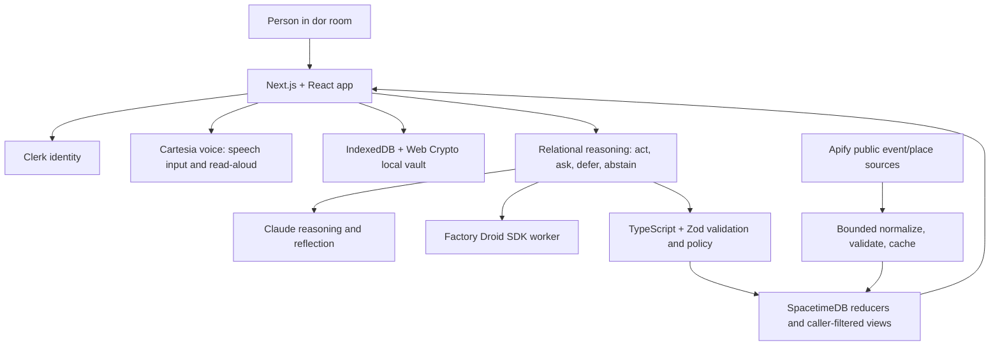

# dor

### Find your way back. Find your way in.

## The connection gap, in numbers

- **About 1 in 6 people worldwide (15.8%) reported loneliness** in the WHO's global estimates. The WHO identifies major life changes—including moving, job loss, breakups, retirement, and bereavement—as drivers of loneliness and social isolation. ([WHO, 2025](https://www.who.int/news-room/questions-and-answers/item/social-connection))
- In a prospective study of young adults moving away to college, networks grew with new relationships, while many pre-transition friendships were relinquished and replaced by more accessible ties. The study also found face-to-face contact played a stronger role than digital media in maintaining ties. ([Kempnich et al., *Advances in Life Course Research*, 2024](https://doi.org/10.1016/j.alcr.2024.100632))
- **AI can offer comfort, but comfort is not the same as reciprocal connection.** In a preregistered, two-week study of 296 first-semester students, daily texting with a randomly paired human peer reduced loneliness; a highly supportive chatbot did not produce the same benefit as peer texting. The authors explicitly caution that this does not show chatbots are harmful. ([Li et al., *Journal of Experimental Social Psychology*, 2026](https://doi.org/10.1016/j.jesp.2026.104911))

Research on AI companionship is still developing: another set of experiments found immediate reductions in loneliness after AI interactions, but no evidence that those reductions persisted between interactions. ([de Freitas et al., *Journal of Consumer Research*, 2025](https://doi.org/10.1093/jcr/ucaf040))

**Our premise:** AI should help people cross the distance between reflection and reaching out. dor uses it to open a door to another person or a real local community—not to stand in for one.

**dor is a connection assistant for life's transitions: it helps you keep meaningful relationships close and find people and places to belong wherever you land.**

> Life will keep opening new doors. dor helps you find your way back—and your way in.

## Why dor

Transitions reshape daily routines, distance, and community all at once. Reaching out can feel awkward; walking into a new room alone can feel harder. dor uses voice and agentic AI to turn personal context into timely openings for real human connection. The AI helps create the moment. People make the connection.

## What dor does

### Keep existing relationships close

- **Voice notebook:** talk or type through a moment. Cartesia powers voice input and spoken follow-up questions; Claude can help reflect on what the user chooses to send for processing.
- **Automatic nudges:** accepted connections can receive an in-app nudge without the sender approving every instance. The reasoning layer can act, ask, defer, or do nothing; it considers timing, relationship context, conflict risk, and whether the moment should remain human-owned.
- **Relationship books:** keep selected photos and interaction notes—such as calls, introductions, and nudge feedback—in a private, encrypted local vault.
- **Responsible stops:** conflict or likely-friction context suppresses a nudge; serious distress surfaces support resources and does not contact a connection. dor does not send personal messages as the user.

### Find your way into a new community

- Set a transition, interests, and a one-time approximate area.
- Explore real local events and places from a server-side public catalogue.
- Discover eligible, opted-in profiles and potential introductions. The user chooses whether to reach out; the other person chooses whether to accept.
- Use event and profile recommendations without making journaling a requirement for discovery.

## One user journey

1. A person arrives somewhere new and completes a short, skippable onboarding.
2. They use the room's notebook to reflect by voice or text, or skip journaling entirely.
3. dor's reasoning layer evaluates whether to act, ask, defer, or abstain. For an accepted relationship, it may create a timely in-app nudge; for a new community, dor can surface a fitting event or eligible connection.
4. The person decides whether to take the next step. A real call, introduction, or shared activity happens between people.

## System architecture



**Data boundaries:** journal text is not copied into a connection's nudge or the public event catalogue. Apify receives a fixed public-source query, not a person's journal, private quiz answers, relationship IDs, attendance intent, or device-derived location. Selected reflection text may be processed by the configured AI provider when the user sends it for reflection. Relationship books use the local encrypted vault.

## Sponsor integrations

### Cartesia — Best Use of Cartesia

Cartesia powers dor's voice notebook: speech-to-text captures a reflection, and text-to-speech reads dor's follow-up question aloud. The user can tap to talk, stop, correct the transcript, and continue by voice or text. Voice is part of the primary reflection flow, while typing remains an accessible alternative.

**What to show:** one voice reflection, a useful follow-up, and the next connection action. Cartesia's supplied judging rubric gives equal weight to problem/originality, meaningful Cartesia use, execution, and impact/responsibility (25% each). Its submission asks for a working demo, a two-minute demo-first presentation, concise setup/Cartesia/limitations documentation, and source access for judges; those are reflected in this README and the demo plan.

### Anthropic — Best Use of Claude

Claude supports reflection and context-sensitive reasoning. When the user chooses **Keep talking**, Claude generates one focused follow-up question; when the user chooses **Send**, selected reflection text can be processed to inform a structured decision. dor's reasoning can act, ask, defer, or abstain instead of turning every reflection into a message. Claude is part of a human-connection workflow, not a standalone chatbot wrapper.

### Factory — Best Use of the Droid SDK

The Factory Droid SDK runs agent work in dor's worker flow. Work is triggered by product events and bounded by typed inputs, time limits, allowed actions, and server-side policy checks. The Backstage view makes the status and outcomes of the coordination path visible, so the demo can show what the agent did instead of merely naming the SDK.

The Factory challenge emphasizes meaningful SDK use, event-triggered work, deliberate limits on agent access, and visible plans/steps/results. dor's worker and Backstage view are designed to demonstrate those aspects; it is not a chatbot with Droid added after the fact.

### Meta — Bringing People Closer Together with AI

Meta's challenge is the product thesis: use AI to strengthen human connection. dor applies AI to existing relationships through automatic in-app nudges and to new communities through relevant events and opt-in introductions. The demo should make AI's contribution visible, then show the human action it enables. The people—not the agent—make the call, accept the introduction, or meet at the event.

### SpacetimeDB

SpacetimeDB is dor's shared-state and real-time coordination layer. Reducers validate state transitions, while caller-filtered views expose only the rows an account may read. It supports relationship state, nudge coordination, event catalogues, and discovery workflows; the frontend receives changes through subscriptions rather than treating the database as a passive storage add-on.

### Apify

Apify supplies public event and place listings for discovery. dor uses configured Actor builds for Luma events, Google Maps places, and Google Events, then normalizes, validates, deduplicates, caches, and ingests the results into its catalogue. The latest verified run populated Maincloud with **170 places and 51 events**. Refresh is manual and consumes credits. Actor inputs are source configuration—not a user's journal, private quiz answers, relationship IDs, exact location, or attendance intent.

### Figma — Best Figma Workflow Hack

Figma was used to plan the frontend page by page: each page had a description, component inventory, visual style, palette, and art direction. The team also used Figma through the Cloud MCP. When MCP credits ran out, the team carried the design plan into Claude Design and continued frontend implementation there. Figma shaped the design workflow; it is not a runtime dependency in dor.

## Live demo and evidence

- **Live room:** [live.doratcalhacks.site](https://live.doratcalhacks.site) during an active demo session.
- **Design walkthrough:** [doratcalhacks.site](https://doratcalhacks.site); this hosted tour uses clearly labeled sample data.
- **Event catalogue:** live Apify ingestion has been verified for Luma events, Google Maps places, and Google Events. The latest README status recorded 170 places and 51 events in Maincloud; refreshes are manual and use provider credits.
- **Notebook:** the live room has verified typed reflection and a real follow-up response. Check microphone capture and spoken playback on the actual presentation device before the demo.
- **Reasoning/Backstage:** the current app exposes the agent's decision path. Keep synthetic visual traces labeled as synthetic; do not present them as live provider or database telemetry.

The demo should show one complete user flow in two minutes: the transition problem, the notebook or discovery UI, the AI's useful contribution, and the resulting human action. Keep the explanation short and make the product visible.

## Built with

Next.js, React, TypeScript, Tailwind CSS, shadcn/ui, SpacetimeDB, Anthropic Claude, Factory Droid SDK, Cartesia, Apify, Clerk, Zod, IndexedDB, and the Web Crypto API.

## Run locally

Requirements: Node.js 20 or newer.

```sh
npm ci
cp .env.example .env.local
# Add local credentials and service configuration to .env.local
npm run dev
```

Never commit `.env.local`, provider keys, or real user data. See [.env.example](.env.example) for variable names and [docs/RUNBOOK.md](docs/RUNBOOK.md) for setup, demo, and reset details.

Useful checks:

```sh
npm run typecheck
npm run test:app
npm run build:app
```

## Known limitations

- New-profile discovery and the complete two-person introduction journey still need end-to-end verification with opted-in participants; demo fixtures must remain labeled.
- Apify catalogue refresh is manual, bounded, and uses credits. Live listings can change or be sparse in a chosen area.
- Verify voice capture and read-aloud on the exact phone or laptop used for judging.
- The agent visualization is explanatory. Only label a trace live when it is connected to real runtime events.
- No social-media scraping of personal accounts is part of the verified discovery pipeline.

## Team and repository ownership

| Person | Role | Main areas owned |
|---|---|---|
| **Rishi** | CS / product integration | App composition and navigation; Clerk and SpacetimeDB client/bindings; catalogue ingestion and Apify integration; deployment and release. Main paths: `src/app/`, `src/components/`, `src/lib/spacetime/`, `src/server/`, `scripts/ingest-catalogue.ts`. |
| **Nimisha** | DS / discovery quality | Candidate retrieval and ranking, matching evaluation, discovery cards and honest no-fit states. Main paths: `src/evaluation/`, `src/features/discovery/`. |
| **Adam** | AI / voice and worker | Cartesia and Claude adapters, Factory Droid SDK worker orchestration, bounded model calls, and provider efficiency. Main paths: `src/agents/`, `worker/`, voice/reflection API routes. |
| **Sumedh** | Cyber / privacy and policy | Vault, consent and authorization semantics, SpacetimeDB security guards/views, privacy controls, and adversarial checks. Main paths: `contracts/src/`, `spacetimedb/src/`, `src/privacy/`, `src/vault/`. |
| **Sumedh** | Relational reasoning | Decision policy and reasoning runtime: decide whether to act, ask, defer, or abstain, and define safe context and intervention boundaries. Main paths: `src/reasoning/core/`, `src/reasoning/runtime/`, reasoning specifications. |

Cross-role API and data contracts live in [`contracts/`](contracts/README.md). Read [`AGENTS.md`](AGENTS.md) before changing code; use [`INSTRUCTIONS.md`](INSTRUCTIONS.md) for the full architecture, project phases, and role handoffs. Continuous updates live in [`docs/updates/`](docs/updates/).

## Source access for judges

Provide judges access to this repository in accordance with Cal Hacks rules. Keep API keys and credentials out of the repository; use local `.env.local` or the hosting provider's secret store.

## More detail

- [Product and implementation guide](INSTRUCTIONS.md)
- [Project status and evidence ledger](PROJECT_KNOWLEDGE.md)
- [System plan](docs/PLAN.md)
- [Automatic nudges](docs/features/AUTOMATIC_NUDGES.md)
- [Live notebook](docs/features/LIVE_NOTEBOOK.md)
- [Reasoning architecture](docs/features/REASONING.md)
- [Apify sources and limits](docs/features/APIFY_SOURCES.md)
- [Demo and video plan](docs/DEMO.md)
