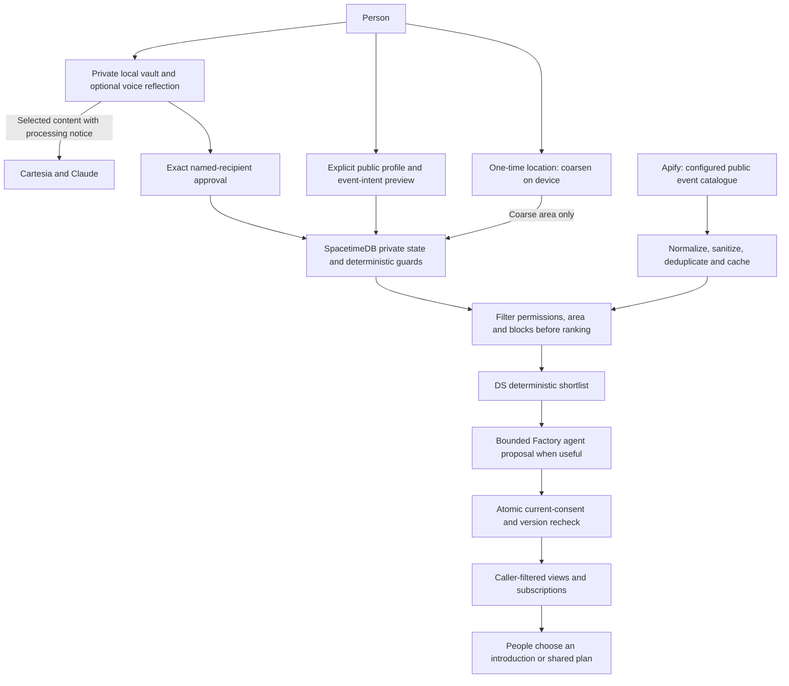

# dor

### AI that helps people connect with people

dor helps people keep existing partner, friend and family relationships alive through private reflection and explicitly approved, recipient-specific invitations to connect. The current release prioritizes that complete journey. Geographical discovery, nearby introductions and same-event matching are preserved as extensions, not core release gates.

The product thesis is that AI should help someone leave a conversation with a bot and start a conversation with a person. This is a design goal to validate, not a claim that AI causes isolation for everyone. dor complements calls and meeting up by reducing the effort of finding the person, reason and moment.

> Private reflection → explicitly approved context → a useful human connection.

## Current direction — core first (2026-10-24)

**This mini patch changes the plan, not runtime behavior.** The core-first milestones below supersede the discovery-first R0–R6 schedule and conflicting priorities in older role/plan documents. Preserve implemented discovery/event code; do not delete it, weaken its guards, or expand it before the core passes live verification. Existing Discover UI is not disabled by this README change; CS must separate it from the core demo in a follow-up. This is not another 36-hour sprint.

**Core journey:** private typed/voice reflection → identify support intent and recipient boundaries → clarify privately when necessary → exact named-recipient preview → explicit approval → bounded coordination → authoritative consent recheck → recipient-only nudge → dismiss, pause or revoke.

### Sponsor targets and implementation evidence

Source: user-supplied **13.0 Hacker Guide.pdf**, PDF pages 11–13 (printed pages 10–12), and the [official prize listing](https://cal-hacks-13-0.devpost.com/). The guide says detailed criteria are on the [live site](https://hive.hackberkeley.org/prizes) and prizes may change. Tool use below is **our implementation/evidence requirement**, not an invented complete sponsor rubric. Credits, installed packages and a sponsor logo do not prove eligibility.

| Target / priority | Required tool contribution in dor | Owner and evidence before claiming readiness |
|---|---|---|
| **Meta/Facebook: Bringing People Closer Together with AI — primary product target** | Demonstrate AI helping an existing partner, friend or family connection while respecting recipient-specific boundaries and human approval. The supplied guide does not specify a required Meta model/API; do not assume Llama, WhatsApp or Meta hardware is mandatory. | **All; CS integrates, Nimisha evaluates.** Show one useful invitation, one private clarification and one correctly suppressed nudge. Confirm any additional technical/submission conditions with the sponsor. |
| **Anthropic: Best use of Claude — primary** | Claude performs meaningful private reflection and structured support/ambiguity reasoning through the authenticated provider path. It must distinguish “want company” from “want this person's company,” without authorizing a disclosure. | **Adam + Nimisha; Sumedh reviews the boundary.** User confirmed the challenge title; the guide still says “Coming soon.” Record real Claude execution, constrained outputs and positive/clarify/no-action cases. Coding with Claude alone is not the product integration we intend to demonstrate. |
| **Factory: Best Use of the Factory Droid SDK — primary, rework in progress** | Rework orchestration to use the actual **Droid SDK** for an application-triggered, bounded workflow over approved signals. Preserve tool restrictions, isolated execution, cancellation, call limits and commit-time policy checks. | **Adam; CS supplies runtime/configuration.** **SDK call path (AI PR, offline-tested, isolated live run):**
- The worker's default transport is `worker/src/droid-sdk.ts`. It uses `createSession`/`session.stream` from `@factory/droid-sdk@0.10.0`, with one locked-down session per prompt.
- `droid exec` remains only as the explicit `DOR_DROID_TRANSPORT=cli` fallback and must not be presented as the SDK integration.
- Live evidence so far uses synthetic stand-ins, not the deployed worker/database: 4/4 cases decided via the SDK. Reproduce with `node worker/scripts/live-droid.mjs --runs 1` (spends Factory credits).
- Deployed end-to-end evidence and final eligibility with Factory remain open. [SDK docs](https://docs.factory.com/sdk/typescript). |
| **Cartesia: Best Use of Cartesia — primary** | Real voice capture/transcription and optional read-aloud in the core journal, with scoped short-lived browser tokens and clear provider-processing copy. | **Adam; CS composes the UI.** Demonstrate record/stop/correct, typed fallback, denied microphone, cancellation and token expiry. A saved API key or mocked audio does not establish a working integration. |
| **SpacetimeDB — core infrastructure; exact challenge title/criteria pending** | Authoritative reducers, private tables, caller-filtered views and live subscriptions for pairs, exact approvals, recipient consent, nudges and revocation. CLI publishing/generation is tooling, not the runtime integration. | **CS + Sumedh.** Two signed-in accounts and a denied third account; revocation during generation; retry without duplicate delivery. Guide lists “Coming soon”; [Spacetime's announcement](https://spacetimedb.com/blog/spacetime-at-calhacks) confirms a usage prize without a complete rubric. Record the exact submission category when confirmed. |
| **Apify: Best use of Apify — conditional extension** | A real server-side Actor/API public activity source, normalized and cached with provenance. Keep personal context, recipient IDs and user-derived location out of Actor input. | **CS; Nimisha ranks permitted results, Sumedh reviews inputs.** Pursue only after the core is complete. If no meaningful live integration ships, omit this submission target. The separate Best Actor category is not claimed merely for consuming an existing Actor. |

No extra tool is being added solely to chase another prize. Sponsor evidence should contain code paths, reproducible synthetic-data demos and content-free usage metrics, never keys, raw journals or private clarification answers. Video/presentation planning remains in [docs/DEMO.md](docs/DEMO.md).

### Reasoning layer and human-in-the-loop behavior

**Status:**
- **Private clarification:** CS loop (#28), with Claude's assessment ([PRIVATE_ASSESSMENT.md](docs/features/PRIVATE_ASSESSMENT.md), D040). Implemented offline; live Claude evidence pending.
- **Durable person-specific pause:** still planned. Its requirements are in [RECIPIENT_PAUSE.md](docs/features/RECIPIENT_PAUSE.md) (Cyber, D041).

**The rules below stay normative.** Existing presets remain category ceilings; a new recipient exclusion can only narrow permission, never broaden the preset. Shared pause/revision interfaces require Cyber/CS/AI review and versioned contracts before implementation.

1. **Private understanding (Claude):** only process content the owner selected under the provider notice. Produce an owner-only assessment of desired support, uncertainty and possible recipient restrictions. Never infer permission from quiz answers, closeness, past approvals or a model confidence score. No lie detection or comparison of friends' private stories.
2. **Deterministic exclusion:** an explicit “not Alex,” pause, unlink, missing consent or stale permission blocks that recipient. Clear refusal is not an invitation to ask again until the user agrees. Keep private explanations out of shared state and peer prompts; a durable pause needs only the minimum restricted control metadata, not its reason.
3. **Three owner-side outcomes:** `no_action`, `needs_clarification`, or `ready_for_preview` are proposed design vocabulary, not new exported schemas. Invalid/ambiguous output, refusal or timeout never means send. A model can suggest a clarification or veto a proposal; it cannot approve delivery.
4. **Private clarification:** ask one natural question at a time, for example “Would company feel good tonight, or would you prefer some space?” Then, only if needed, “Is there someone you would feel comfortable hearing from?” Questions must not disclose another person's private data or imply that anyone has already been notified. Explain that answers help shape private suggestions; do not conceal that sharing is possible later. Offer skip/not now. Proposed cap: two questions, then no action if unresolved; no repeated pressure or background retry after dismissal.
5. **Explicit sharing decision:** a clarification answer is never consent. Show the exact approved fields, named recipient and recipient-facing template, then ask separately whether to share. Bind approval to that recipient and revision. Editing the recipient or payload requires a fresh preview/approval. Only an approved signal can trigger shared coordination; journal activity alone must not determine outreach timing or audience.
6. **Bounded coordination (Factory SDK rework):** use approved enums and recipient-consented preferences only. No raw story, exclusion explanation, private reflection, free-form question or hidden chain-of-thought in peer prompts/logs. Prefer deterministic filtering first; invoke reasoning only when useful. Existing safe-template fallback must never bypass unresolved relational ambiguity or a pause.
7. **Atomic delivery (SpacetimeDB):** recheck current identity, accepted pair, preset/assignment/item consent versions, recipient opt-in/preferences, expiry, quiet hours, cooldown and revocation. Add the reviewed pause version/check before enabling the new feature; an old queued job must not survive a new pause. Recipient copy stays in approved fixed templates. Suppression is silent to the other person: no “they avoided you” or “the AI decided not to notify you” receipt.

**Private-event acceptance case:** someone declines a friend's invitation saying they are sick, later attends a party, and mentions it privately. No “ask about Friday,” event hint, whereabouts, contradiction alert or hidden-story explanation may reach that friend. General availability is not willingness to see every person. If the user explicitly excludes that friend, suppress; if intent is unclear, clarify privately and require fresh explicit approval before any sharing. Never fabricate a cover story. We can reduce disclosure risk; we cannot guarantee that all human inference or relationship friction is impossible.

**Data lifetime:** keep clarification questions/answers and pending assessments in the owner's current session by default; discard on completion, cancellation, lock or account change. Persistence needs a reviewed local-vault design. Neither raw answers nor reasons belong in SpacetimeDB, analytics, Factory coordination sessions or team logs. Minimal content-free decision codes are enough for synthetic evaluation.

### Core product requirements — coverage and acceptance

These are the actionable conclusions governing this release, not a transcript of external feedback. They are requirements for the next implementation work, not claims of completed protections. **Adam already owns the Droid SDK rework; other agents must not duplicate or replace that work.**

| Conclusion | Required behavior | Acceptance evidence / owner |
|---|---|---|
| Depth before breadth | Complete and polish the existing-relationship journey before geographical scanning, nearby recommendations or event matching. Preserve extension code and safeguards without making those features necessary for the core demo. | **CS + all:** core works with discovery disabled and without location permission or an event source. |
| Connection is person-specific | Wanting company, having free time, or seeing other friends does not imply wanting to see this friend. Interpret negative and uncertain recipient intent before offering a share preview. Never generalize one person's permission to all friends or everyone on the same preset. | **Nimisha + Adam:** paired fixtures with identical general availability but different recipient intent yield different eligibility; **Sumedh:** excluded recipient cannot be approved or delivered to. |
| Indirect disclosure counts | A question, timing choice, notification title, badge, receipt or explanation must not hint at an unapproved party, activity, location, excuse or interpersonal tension. Safe-looking wording alone is insufficient if its topic or timing reveals the hidden story. | **Sumedh + CS:** inspect every recipient-visible surface; **Nimisha:** hold approved inputs/delivery settings constant while varying the private story and check that recipient-visible content and scheduling do not change. |
| Reasoning must know when to abstain | Detect relational uncertainty rather than treating a generic support match as sufficient. An explicit refusal blocks; ambiguity routes to the owner; a positive assessment only enables a preview. A confidence score never overrides a boundary. | **Adam + Nimisha:** separate positive, explicit-no and unclear cases; malformed outputs and unavailable reasoning cannot silently become authorization. |
| Clarification is private and neutral | Ask about the owner's wishes, not whether the software should tip off a friend. Do not mention a queued nudge or imply another person requested information. Do not use leading questions to steer toward delivery. The product still explains that private suggestions may later be shared only with approval. | **CS + Nimisha:** “Would you prefer some space from this person for now?” is acceptable; “Should I tell them to ask about your Friday night?” is not. User can skip or stop without any outbound effect. |
| Clarification changes understanding, not permission | A useful answer may move the private assessment toward no action or a share preview, never directly to send. No answer, contradictory answers, unresolved recipient identity or the question cap leave sharing blocked. Do not guess which friend the user meant. | **Adam + CS:** answer → new private assessment → separate exact recipient approval. Test dismiss, timeout, ambiguous names and a changed answer; no signal/job is created by answering alone. |
| Temporary boundaries are respected | Offer explicit episode-only exclusion or a clearly scoped pause, subject to reviewed contracts. Show who is paused and the duration to the owner only; never require the user to justify it. A later answer or expired pause must not resurrect an old rejected candidate or queued job. | **Sumedh + CS:** pause invalidates pending work; resume/expiry requires a fresh current preview and approval for any new disclosure. Leaving one person out must not notify them or automatically choose someone else. |
| Success includes choosing silence | The product should help a wanted human interaction happen, not maximize notification volume, journal engagement or model calls. Count correct no-action decisions as successful behavior. Do not promise zero relationship conflict or guarantee that previously seen information can be forgotten. | **Nimisha:** report useful approved invitations, unwanted suggestions, forbidden disclosures, appropriate abstentions and clarification usefulness separately; two teammate reviews with sample size disclosed. |

**Reasoning examples to implement and evaluate:**

- **Positive:** “I would like a short call with Sam.” Show a Sam-specific preview if all policy conditions permit it; nothing is sent until approval and recipient opt-in checks pass.
- **Explicit exclusion:** “I want company, but not Alex tonight.” Exclude Alex without requesting a reason. Do not automatically notify another friend; the owner must choose and approve any other recipient.
- **Uncertain:** “I miss them, but I am not sure I want to talk tonight.” Ask one neutral private question. Skipping means no action, not an optimistic fallback.
- **Private-party scenario:** a private account of attending a party after declining a friend's invitation creates no Friday-night question, activity hint or contradiction alert. Do not police truthfulness or generate an excuse.
- **Change of mind:** an owner pauses the recipient while generation is underway. Reject the old result at commit and suppress pending derived delivery. An old retry, reconnect, later clarification or pause expiry cannot restore that authorization.

**Implementation boundary:** the private assessment happens before any shared coordination. The peer agent must not be asked whether the owner is avoiding it, and must never see the clarification, refusal reason or hidden story. Proposed recipient-pause metadata is enforcement state with restricted access, not a new shared emotional signal. New schemas, retention rules and state transitions need affected owner review; this README alone does not authorize a production wire change.

### Where implementation actually stands

Inspected main: **e5796db**, including PRs through #35. The older baseline inventory below is retained as history, not current status. Code presence and offline evidence are not deployed proof. Live evidence so far is limited to a local SpacetimeDB (`dor-local`) on one developer machine with real Clerk dev JWTs; nothing is hosted or deployed.

| Area | Current evidence | Next core work |
|---|---|---|
| Local journal / voice / privacy | Implemented on main: per-account vault composition, VaultControls, VoiceReflection, saved entries, generated bindings (`npm run bindings:check` plus a CI job guard drift); onboarding resets on vault lock; quiz results become unsaved preset drafts. Offline-verified. | Verify real-browser lifecycle, microphone and configured providers; browser UI path not yet exercised live. |
| Exact recipient sharing | Implemented on main: ShareReview, payload/revision-bound approval, recipient support/delivery settings, approved-signal revocation UI. Live (local module, real Clerk dev JWTs): `scripts/smoke-core3.ts` 26/26 covering pairing, approve, sender-only views, denied third account, wrong revision refused, revoke/replay no resurrection, reconnect, bad/anonymous tokens refused. `--sweep` 30/30 (sweep marked an expired preference about 42 s after expiry). Not hosted. | Repeat against a hosted deploy once the owner decides; Cyber: narrower `my_nudges` row, sender-only receipt actions and reason code. |
| Guarded coordination | Implemented and offline-verified: consent-bound worker adapters, reducer authorization, caller-filtered views, expiry handling, fixed templates, Droid SDK transport default with a 25 s job budget. **Not verified live:** nudge delivery through the worker/Droid (paid) was not run. | AI: worker reconnect, nickname exclusions, paid Stage C run; verify worker identity and races end to end. |
| Recipient-specific avoidance / clarification | Implemented on main and offline-verified: CS private decision loop (question/skip/answer, 2-question cap, never auto-chooses); D040 assessment only narrows (can veto or skip a question); strict candidate parse (malformed means no action); unnamed or duplicate connection labels and fail-closed exclusion of unnamed connections when the assessment names someone; D041 durable pause (Cyber) with CS controls (Connections pause/resume, Privacy active-pauses list, paused recipients never offered). Pause not yet exercised against a running module; Claude live run not done. | Pause against a running module; live Claude run on synthetic cases (needs key and go-ahead); DS to label the new cases. |
| Geography / events | Discover UI, paged area-filtered cards, introductions, event/plan guards and DS evaluation code exist (offline, synthetic). | Preserve as extension; not a core acceptance dependency. |
| Release readiness | Offline checks documented in role logs. Local live smoke above. Hosted deploy not done. Installable PWA implemented (manifest, icons, static-assets-only service worker; in-app delivery only, no push notifications): builds and serves, not yet checked on a phone. Not verified: browser UI path, Cartesia live, any hosted deploy. | Hosted deploy (owner decision pending); see [RUNBOOK](docs/RUNBOOK.md); no full live completion claim. |

### Immediate core milestones and balanced ownership

Use actual time remaining; these milestones supersede the old geographical R2/R3 release gates. All four owners work in parallel within each gate. Preserve the detailed older tasks as a reference, not a second active backlog.

| Gate | CS — you | DS — Nimisha | AI — Adam | Cyber — Sumedh | Exit evidence |
|---|---|---|---|---|---|
| **Core 1: reconcile and define boundaries** | Reconcile latest main/open PRs; verify current sharing/settings UI; claim clarification UI and pause-control integration. | Define support/avoid/uncertain expected outcomes and forbidden disclosure labels before evaluating models. | Specify private assessment/clarification seam and SDK migration plan; keep private Claude and approved-only Factory contexts separate. | Define negative recipient restriction, expiry/version, access and commit-time semantics; review new interfaces with producers/consumers. | Shared reviewed proposal; exact file claims; no silent runtime contract changes. |
| **Core 2: implement the private decision loop** | Compose question/skip/answer states into journal; reuse exact recipient preview; clear state on lock/account switch; integrate explicit pause controls after contracts land. | Add paired scenarios: company generally vs this friend, explicit refusal, ambiguous timing, skipped question, changed answer and prompt injection. | Implement bounded structured assessment and at most two clarifications; invalid/refused/timeout → no delivery; actual SDK workflow over approved inputs. | Implement authoritative pause checks at approval/use/commit and invalidation of queued/visible derived work; owner-only controls and reason-free outputs. | Positive, clarify and no-action journeys offline; no content or question answer crosses the sharing boundary. |
| **Core 3: connect and verify live** | Configure module/auth/bindings/worker, run two-account plus denied-third-account journey; verify approval, revoke and reconnect. | Two teammate ratings on eligible usefulness; report unsafe suggestions separately from missed suggestions; compare deterministic baseline. | Verify Claude/Cartesia/SDK with synthetic inputs; measure calls, total latency, queue/retry limits, cancellation and graceful provider failure. | Test direct reducer bypasses, pause/revoke during generation, stale approval replay, wrong-recipient access and private logging. | Reproducible core journey on real services; deny/race cases produce no unauthorized delivery. |
| **Core 4: stabilize and prepare submission** | Separate extension UI from core demo; fix blockers and prepare reproducible run/reset instructions. | Choose partner/friend/family examples plus the private-party no-action case; record actual sample size and limitations. | Freeze tested SDK/provider config; supply sanitized integration/cost evidence, not unsupported savings claims. | Final privacy-copy/control review; verify expiry, delete-vs-revoke behavior and account-switch cleanup. | Stable demo + verified sponsor checklist; incomplete integrations labeled honestly. |

CS status per gate (as of main e5796db): Core 1 done; Core 2 done, including D041 pause controls (offline-verified); Core 3 partial, local live only (smoke 26/26, sweep 30/30; worker/Droid delivery, browser UI path, pause against a running module and hosted deploy not verified); Core 4 in progress (runbook and PWA).

**Core definition of done:** one useful approved nudge, one clarification that remains private until separately approved, and one explicit person-specific refusal that cannot deliver despite retries. Reproduce partner/friend/family cases, clear private state on lock/sign-out, handle failed microphone/provider paths, and prove a revoked/paused signal cannot produce a new visible nudge. Do not claim this is done from a build, an offline harness, or a configured key alone.

## Start here

1. Read [AGENTS.md](AGENTS.md), [PRD.md](PRD.md), [PROJECT_KNOWLEDGE.md](PROJECT_KNOWLEDGE.md) and [contracts/README.md](contracts/README.md).
2. Read [shared dependencies](docs/PLAN.md), [selected stack](docs/TECH_STACK.md) and the contract specs.
3. Open your role: [CS](docs/roles/cs.md), [Nimisha / DS](docs/roles/ds.md), [Adam / AI](docs/roles/ai.md), [Sumedh / Cyber](docs/roles/cyber.md), then your handoff and all update logs.
4. Merge main into your active role branch. Preserve implementation already completed. **Core 1–4 above are the active milestones. R0–R6 below are historical planning/reference only.** Historical P IDs remain in logs as evidence.
5. [Forwardable team messages](docs/team-messages/README.md) explain what changed. Video/presentation work stays separate in [docs/DEMO.md](docs/DEMO.md).

## Original three-experience vision — core plus deferred extensions

| Experience | Example | What dor does | Human decision |
|---|---|---|---|
| Keep a connection | A partner away from home, an old friend or a family member | Private voice/typed reflection, exact approved signal, bounded agent coordination and a useful nudge | Approve sharing; choose whether to call, send a note or make a plan |
| Meet nearby people | Someone has just moved to a neighborhood or campus | One-time approximate location, opted-in public profiles and matching on published interests | Publish a profile; inspect people before inviting; accept or decline an introduction |
| Find company for an event | Two people want to attend the same local workshop | Public event discovery plus explicitly shared event intent; a concrete activity proposal | Choose what event intent to publish and accept the same plan revision |

All original partner/friend/family functionality stays. Nearby discovery is not limited to people who are lonely or whose relationships are broken. A useful first session should work without writing a journal or inviting an existing friend.

**User-confirmed design:** use a one-time approximate location, not background tracking. Show opted-in public profiles before an invitation is accepted. Public means the published fields are visible to eligible signed-in discoverers, not a globally readable database or a public journal. The proposed initial audience and retention rules are detailed in [LOCAL_CONNECTIONS.md](docs/features/LOCAL_CONNECTIONS.md).

The skippable 6–8-question quiz still personalizes communication style, support, bandwidth and draft sharing preferences. It never grants disclosure consent. Established connections use explicitly confirmed partner/friend/family presets with named per-item approvals. Stranger discovery has a separate explicit publication choice; it cannot inherit those presets.

## Historical implementation inventory — superseded by the current checkpoint above

Inspected baseline: main through `d7285eb`, including latest Cyber vault/F5/F7 work and AI/DS PRs #7/#8. This is an evidence-based reset of the documentation. Old handoffs retain their original commit-specific history; the current table and PROJECT_KNOWLEDGE take precedence for present status.

| Area | Implemented on inspected main | Still required |
|---|---|---|
| App / identity / bindings | Next.js pages, quiz, Clerk-aware routes and Spacetime client adapter | Replace composition-root placeholders; actual generated bindings, configured identities and deployed browser verification |
| Vault | `LocalVault`, Web Crypto, IndexedDB adapter, recovery/lock lifecycle, profile/extras and reflection-text storage | Wire per-account instance and UI; real-browser persistence, pagehide and account-switch checks |
| Existing connection guards | One shared policy; guarded approval, opt-in/delivery, worker-only commit, caller-filtered views | Authoritative recipient support-preference storage + commit binding; expiry/snooze visibility; JWT audience; scoped rate limits |
| AI / voice | Claude/Cartesia adapters, authenticated routes, browser voice helpers; real-policy worker factory and replay ledger | Journal UI and database adapters, browser/provider live runs, deployed worker |
| Droid efficiency | Haiku default and reused private working directory; Adam recorded isolated live comparisons | Concurrent execution/total deadlines; independent whole-pipeline cost and quality measurements |
| DS | Quiz fixtures, 30 support cases; ACK rank hook; 12 activity cases, ranker and baseline results | Reviewed canonical C7/C8 exports, nearby/event cases, independent human usefulness ratings |
| Apify | Executable input/link guards in `contracts/src/catalogue.ts` | Actual selected source/Actor, ingestion/cache, catalogue schema and live retrieval |
| Nearby / event introductions | User-approved requirements in this reset | C8 schemas, coarse-area matching, opted-in profiles, event intents, invitations and guarded delivery |
| Deployment | Offline code/test evidence and attributed isolated Droid evidence | Full app + database + providers together; no end-to-end live claim yet |

**Implemented is not integrated; integrated is not deployed; deployed is not live-verified.** The presence of a guard, adapter or passing synthetic case does not establish that the full application currently works. The reset changes planning/documentation only; it does not silently change runtime permissions or mark C7/C8 as shipped.

## Architecture and trust boundaries



“Nearby agents” means logical dor agents for users who opted into discovery. It does not mean scanning phones, Wi-Fi, Bluetooth, private contacts or nonusers. Area matching is eligibility, not proof that someone is physically present. Public event interest is self-declared; scraping a listing does not reveal who will attend.

No journals, transcripts, inferred sensitive facts, embeddings, exact coordinates or habitual movement histories enter shared agent prompts. Publication allows only deliberately selected fields. Private tables plus caller-filtered views remain the database model; location is not made globally public to simplify matching.

## Balanced ownership

Each person owns implementation, a usable feature surface, tests and a handoff. Equal responsibility means comparable blocks of work; the initial estimates are not measured labor hours. Rebalance at every gate if one person is blocked or overloaded. CS integrates components but does not write all four workstreams.

| Owner | Main implementation | New feature surface | Explicit handoff |
|---|---|---|---|
| CS — you | App composition, verified identity/bindings, module publishing, Apify catalogue/cache and deployment | Thin Discover/event pages, location/profile setup and accepted-plan integration | Generated bindings, catalogue API and page contracts |
| Nimisha — DS | Quiz/profile semantics, deterministic nearby/event ranking, retrieval criteria, quality evaluation | `src/features/discovery/`: result cards, approved reason labels and empty states | Tested rank hook + component receiving authorized props |
| Adam — AI | Voice/reflection, worker/database adapters, bounded proposals and efficiency | `src/features/voice/`: record/stop/correct/reflection experience | Provider component + database-backed worker and call metrics |
| Sumedh — Cyber | Vault, consent/policy, recipient preferences, discovery/abuse guards and tests | `src/features/privacy/`: create/unlock/recovery/privacy controls | Drop-in privacy component + authoritative guards/views |

New component paths are assignments, not existing implementation. Claim files before editing; CS retains shared navigation/layout. Cyber's existing claims for signals/delivery/coordination/policy/views remain intact. All cross-role wire types are exported from `@dor/contracts`, not duplicated in a feature folder. Shared package reviews require affected producer/consumer ACKs; this plan does not forge those ACKs.

## Historical R0–R6 execution phases — not the current release gates

The original sprint is still 36 hours, with only the original 30 minutes allocated to planning. Do not restart that clock. At resumption, write down the actual remaining budget **B** and finish time. The percentages below allocate B and sum to 100%; they are planning estimates, not known time remaining. R0 is capped at 30 minutes, and any surplus goes to R6. Example only: if B = 18 hours, the approximate blocks are 0.5 / 3.25 / 4 / 4 / 2.75 / 2 / 1.5 hours, capped to the actual deadline.

All four owners work concurrently within a phase. Move completed tasks forward without repeating them. If the deadline is close, reduce scope transparently and preserve R5 verification and R6 recovery. No API keys are required to implement the seams or run synthetic checks; actual provider tests wait for the configured environment.

### R0 · Reconcile the latest build and freeze the new seams

**Time:** 3% of remaining time, at most 30 minutes. **Purpose:** Keep completed implementation; replace stale assignments and agree the new discovery boundary before independent coding.

| Owner / task | Detailed deliverable | Evidence and next consumer |
|---|---|---|
| CS — you · `CS-R0` | Merge current main into your existing role branch. ACK the provider-route claims and vault/guard integration seams. Inventory placeholder bindings and environment needs. Select one preconfigured launch area and one public event source with Apify; do not start a paid run for planning. | **Check:** One ownership map, one source configuration proposal and exact shared binding paths. **Handoff:** All: module/config seam; Nimisha: catalogue sample; Sumedh: C7/C8 schema proposal. |
| Nimisha — DS · `DS-R0` | Keep rankAckOptions, rankActivities and the 30+12 fixtures. Specify discovery ranking fields, bounded candidate retrieval and allowed explanation codes. Claim the new discover-results component and define its props. | **Check:** Approved/public inputs are distinguished from private quiz extras; a cold-start case is labeled. **Handoff:** CS/Adam: typed consumer requirements and deterministic sample results. |
| Adam — AI · `AI-R0` | Keep the Haiku/reused-directory Droid path and existing routes/browser helpers. Claim the voice feature component and worker-side adapters. Propose an aggregate deadline, concurrency cap and call budget. | **Check:** A list of real vs fake dependencies, no new provider spend, and current exact adapter names. **Handoff:** CS: component/route interface; Sumedh: worker authority and preference consent requirements. |
| Sumedh — Cyber · `CYBER-R0` | Keep LocalVault, F5/F7 reducers and D028 guards. Review C8 public-profile/approximate-area proposal separately from C3 pair consent. Claim support-preference storage, expiry and audience guard files. | **Check:** No silent extension of relationship presets or Apify query input; review checklist assigned. **Handoff:** All: schema/reducer rejection cases and precise permitted fields. |

**Exit gate:** Every missing interface has a producer, consumer and file claim. No one repeats completed bootstrap work.

**If blocked:** If a shared schema is unresolved, continue UI/rank/adapter work on explicitly synthetic fixtures; shared delivery remains disabled.

### R1 · Finish the existing connection path and implement new discovery contracts

**Time:** 18% of remaining time. **Purpose:** Close the current integration gaps while building the new public-profile/area/event-intent foundation in parallel.

| Owner / task | Detailed deliverable | Evidence and next consumer |
|---|---|---|
| CS — you · `CS-R1` | Wire per-account LocalVault and lifecycle subscription, widen ReflectionPort to PrivateReflection and compose Adam/Sumedh feature components. Generate actual module bindings and configure verified account/worker identities. Publish C7/C8 canonical schema changes with affected owners; apply D027 Q2 copy. | **Check:** Typed journal save/unlock and device-only preview work; generated bindings are reproducible, or live prerequisite blocker is named. **Handoff:** Adam: generated reducer/view bindings; Sumedh: vault integration; Nimisha: reviewed C7/C8 exports. |
| Nimisha — DS · `DS-R1` | Adapt ActivityItem to reviewed C7 without parallel wire types. Implement pure nearby matching using only published interests, approved event intent and permitted area eligibility. Build discover cards/empty states against synthetic C8 data; explain overlap without a compatibility percentage. | **Check:** Same input gives same result; block/expiry/missing consent never enters the eligible rank set; empty area stays honest. **Handoff:** CS: discover-results component; Adam: canonical pure ranking port and fixtures. |
| Adam — AI · `AI-R1` | Build the voice/reflection feature component using current clients: record, stop, correction, cancel, typed fallback. Implement worker adapters for worker_signal_context, worker_delivery and commit_nudge with CS-generated bindings. Wire DS rank via reviewed shared port. Serialize the reused Droid directory or use isolated pool slots before enabling concurrent jobs. | **Check:** No production fake; reflected text persists locally, candidate stays in memory; missing recipient consent returns no result. **Handoff:** CS: drop-in voice component; Cyber: exact read/commit mapping and version bindings. |
| Sumedh — Cyber · `CYBER-R1` | Implement authoritative recipient support-preference consent and bind its ID/version and expiry into commit_nudge. Add JWT audience validation and expiry/snooze enforcement. Build vault create/unlock/recovery/privacy controls as an isolated feature component. Review/implement C8 publish/withdraw/block guards in claimed files. | **Check:** Direct-reducer tests cover wrong caller, preference revocation during generation, expired view state and blocked discovery; privacy controls exercise real LocalVault. **Handoff:** Adam: preference view/guard; CS: privacy component and guarded state contracts. |

**Exit gate:** Existing typed reflection-to-nudge flow has all real adapter implementations; C7/C8 schema, fixtures and guards are reviewed before shared discovery is enabled.

**If blocked:** Credentials can defer live execution, not implementation of identity/consent checks. Keep all data synthetic until the real boundary passes.

### R2 · Ship the nearby introduction vertical slice

**Time:** 22% of remaining time. **Purpose:** Make the expanded product real: choose an approximate area once, publish an opt-in profile, find a useful person and deliberately invite them.

| Owner / task | Detailed deliverable | Evidence and next consumer |
|---|---|---|
| CS — you · `CS-R2` | Implement explicit one-time location capture, on-device coarsening and immediate coordinate discard. Add area/profile setup and thin Discover page composition. Wire indexed area/topic candidate queries, profile publication and invite/accept reducers to caller-filtered subscriptions. | **Check:** No precise coordinate in network/storage/logs; only opted-in profiles appear; two accounts can create an accepted introduction. **Handoff:** Nimisha: authorized candidate page + cursor; Adam: change-trigger/job and profile versions; Cyber: network trace. |
| Nimisha — DS · `DS-R2` | Finish deterministic shortlist, cap candidates, stable tie-breaks, duplicate removal and no-fit logic. Render chosen public name/avatar/interests and safe reason codes. Add sparse-area, already-connected, withdrawn, blocked and coarse-cell-edge cases. | **Check:** Rank never needs a journal, diagnosis, routine or exact distance; public result fields equal the approved profile projection. **Handoff:** CS: fully usable discovery feature; Adam: at most top three eligible candidates with allowed reasons. |
| Adam — AI · `AI-R2` | Implement bounded logical agent exchange over C8-approved cards after deterministic eligibility. Produce an introduction suggestion or no action, never an unsolicited message. Skip model calls for zero choices; benchmark deterministic single-choice mode; recheck profiles/blocks before commit. | **Check:** At most one initial call plus one permitted repair for a shortlisted proposal; zero raw journals/coordinates in prompts; stale opt-out cannot publish. **Handoff:** CS: proposal/result state; Sumedh: generation-race cases; Nimisha: outcome vs ranking evidence. |
| Sumedh — Cyber · `CYBER-R2` | Enforce authenticated discovery audience, explicit profile publication, private coarse-area membership and TTL. Implement withdraw, block/report and invite limits. Ensure strangers cannot access pair signals, support preferences, raw quiz answers or exact location. | **Check:** Third-account/direct-view tests, withdrawal during generation, repeat-probe limits and invitation replay checks pass offline; browser/live proof still separate. **Handoff:** CS: controls and enforcement matrix; Adam: final authorized projection and commit guards. |

**Exit gate:** A newcomer sees opted-in public profiles before sending an invite, receives a concrete reason to connect, and can decline, withdraw or block. Direct interaction requires recipient acceptance.

**If blocked:** If density is low, show a truthful empty state plus public events. Never invent real nearby users or silently widen location precision.

### R3 · Connect people through local events and shared plans

**Time:** 22% of remaining time. **Purpose:** Add a concrete reason to return: a real local event and another person who explicitly wants company there.

| Owner / task | Detailed deliverable | Evidence and next consumer |
|---|---|---|
| CS — you · `CS-R3` | Implement one Apify public catalogue using D028 guards, pinned source/build, bounded asynchronous ingestion, dedupe and shared cache. Use a developer-configured city/campus feed, never device-derived location in Actor input. Compose event pages and proposal acceptance controls. | **Check:** One real source can yield normalized records with source URL, fetchedAt/timezone/unknown fields; stale-cache/failure states work. **Handoff:** Nimisha: C7 records; Adam: stable event IDs; Cyber: input/run metadata and proposal transitions. |
| Nimisha — DS · `DS-R3` | Implement event eligibility and overlap from explicitly published event intent, not scraped attendance. Extend ranker to in-person events/approved coarse area; retain online activities for existing long-distance connections. Build event-result cards and first-session recommendations. | **Check:** Duplicate listings resolve consistently; expired/cancelled/wrong-area events excluded; interest is not labeled attendance; no private Q5 export. **Handoff:** Adam: event shortlist; CS: components and source-status labels; team: new held-out cases. |
| Adam — AI · `AI-R3` | Add bounded event-based introduction and shared-plan proposals selected only from normalized catalogue IDs. Distinguish discovery opt-in from pair activity approval. Implement expiry/cancel/retry handling and human acceptance of the same proposal revision. | **Check:** No web/tool action from scraped titles; no automatic RSVP, booking, message or external purchase; profile/event changes suppress stale proposals. **Handoff:** CS/Cyber: exact proposal state and guarded finalization; Nimisha: decision traces without private content. |
| Sumedh — Cyber · `CYBER-R3` | Implement reviewed C7 activity approvals, C8 event-intent visibility, own-action acceptance and finalization guards. Validate source freshness, both current approvals and matching proposal revision. Review optional public venue tags without habitual-visit disclosure. | **Check:** Wrong event/user/revision, one-sided acceptance, revoke-after-first-accept, block and expired catalogue all refuse finalization. **Handoff:** All: green boundary tests; CS: exact preview copy and event-intent withdrawal. |

**Exit gate:** Two users discover the same source-backed local event, explicitly choose to connect, and accept a current shared plan. Existing partner/friend/family journeys still work.

**If blocked:** If the source is unavailable, keep cached age visible or show unavailable. Synthetic events remain labeled; never claim a live Apify integration from fixtures.

### R4 · Improve usefulness, efficiency and failure behavior

**Time:** 15% of remaining time. **Purpose:** Measure actual outcomes and call counts; make the product inexpensive by avoiding unnecessary work rather than weakening safeguards.

| Owner / task | Detailed deliverable | Evidence and next consumer |
|---|---|---|
| CS — you · `CS-R4` | Measure indexed query/read counts and subscription payloads; remove table-wide scans on hot owner/pair/area paths. Verify one shared catalogue refresh per configured region/window, single-flight refresh and source cost caps. Exercise reconnect and identity switching. Expand CI beyond contract-only checks using a supported Node runtime. | **Check:** No Actor per page render, no full-user enumeration, no duplicate active subscriptions; numbers include dataset size and cache state. **Handoff:** Adam/Nimisha: latency/candidate counts; Sumedh: scoped cache/subscription invalidation. |
| Nimisha — DS · `DS-R4` | Add at least 12 nearby/event cases beyond the existing 30 support + 12 activity cases. Get two teammate ratings on held-out useful introductions, measure no-fit/false-match coverage and compare baseline. Track invite accepted and optional plan completion instead of chat length. | **Check:** Results separate synthetic labels from human ratings; disclose tiny sample size; evaluate expensive AI against deterministic baseline. **Handoff:** All: release decision by case and metric; Adam: cases where model adds measurable value. |
| Adam — AI · `AI-R4` | Measure 10+ eligible provider runs when keys arrive. Right-size reflection output/model using quality checks; add request dedupe without persistent private-result cache, total deadlines/cancellation, retry policy and worker concurrency bounds. Track all usage/fallback outcomes. Verify token expiry and stateful audio resampling across small microphone frames; bound browser TTS input. | **Check:** Cost per successful useful result, median/p95 including failures, model/cache/attempt counts; retained safety checks; no unsupported savings claim. **Handoff:** CS: tested runtime budget; Cyber: dedupe/retention boundaries; DS: quality regression cases. |
| Sumedh — Cyber · `CYBER-R4` | Run cross-user access, payload injection, withdrawal/revocation races, account switch and browser vault tests. Validate rate-limit scope across instances, expired token behavior, metadata-only telemetry, source-link safety and profile abuse controls. | **Check:** Current fixed adversarial suite passes; no sender-visible recipient outcome codes; no unsupported provider-retention or E2E claim. **Handoff:** All: release-blocking findings and exact reproduction; CS: privacy acceptance conditions. |

**Exit gate:** All three experiences have useful outcomes, measured call budgets and passing current privacy gates. Known failures remain visible; targets are not reported as achievements.

**If blocked:** Cut extra feeds, animations or free-form agent negotiation first. Never cut consent checks, explicit public-profile opt-in or block/withdraw behavior.

### R5 · Morning live verification and release candidate

**Time:** 12% of remaining time. **Purpose:** Use API keys to prove the integrated product with controlled synthetic accounts, not to discover missing implementation for the first time.

| Owner / task | Detailed deliverable | Evidence and next consumer |
|---|---|---|
| CS — you · `CS-R5` | Configure Clerk issuer/audience and publish module/generate bindings. Deploy app and source adapter, verify two human accounts plus denied third account. Complete fresh-install and identity-change smoke checks on a fixed revision. | **Check:** Published module, configured environment and browser flow have recorded revision/results; keys remain local/host secrets. **Handoff:** All: tested preview and reset steps; Adam: deployed worker identity and endpoints. |
| Nimisha — DS · `DS-R5` | Run partner, friend, family, newcomer and same-event scenarios against the release candidate. Verify real source normalization against fixture assumptions and review first-use copy with teammates. | **Check:** Actual visible recommendation matches authorized input and source; five scenarios reproducible. **Handoff:** CS: release quality verdict and remaining empty/no-fit cases. |
| Adam — AI · `AI-R5` | Verify direct Claude reflection, Cartesia STT/TTS, deployed Factory worker and database-backed commit. Test mic denial, stop/cancel, token expiry, cold/warm calls and upstream failure with total budget limits. | **Check:** Provider-by-provider success and end-to-end trace reported separately; no fixture policy or preferences in live mode. **Handoff:** CS: worker runbook/restart; Cyber: sanitized processing and token trace. |
| Sumedh — Cyber · `CYBER-R5` | Repeat direct reducer/view attacks on deployed identities and inspect browser network/IndexedDB. Verify preference revocation at commit, profile withdraw/block, timed expiry, account switching and provider notices. | **Check:** Live access control evidence accompanies harness results; any leak blocks real-user mode. **Handoff:** Team: explicit privacy release conditions and honest limitations. |

**Exit gate:** A fixed candidate revision works with actual providers and authoritative state. Each failure has a named owner; no mocked/live ambiguity.

**If blocked:** If a provider fails, typed input/no suggestion and truthful source-unavailable states remain. Do not put keys into logs or switch to production fake adapters.

### R6 · Freeze, hand off and reserve recovery time

**Time:** 8% of remaining time. **Purpose:** Protect a stable build and leave enough time for deployment failures and an understandable handoff.

| Owner / task | Detailed deliverable | Evidence and next consumer |
|---|---|---|
| CS — you · `CS-R6` | Freeze app/schema/source configuration, verify deployment revision, write rollback/reset instructions and fix only release blockers. Keep video/presentation tasks in docs/DEMO.md. | **Check:** Same reviewed revision runs and rollback path is known. **Handoff:** Team: release revision and environment map. |
| Nimisha — DS · `DS-R6` | Freeze fixtures/labels/results and document cold-start/source coverage limits. Validate only changed regression cases after freeze. | **Check:** Quality results reproducible without real journals or relabeling misses. **Handoff:** Team: quality summary and later research questions. |
| Adam — AI · `AI-R6` | Freeze prompt/model/call-budget configuration and verify worker health/restart. Document cancellation and safe provider-failure behavior. | **Check:** No last-minute tool expansion or unmeasured model switch. **Handoff:** CS: runtime recovery and final provider evidence. |
| Sumedh — Cyber · `CYBER-R6` | Review only changed security boundaries; confirm no debug credentials, public private tables or raw journal traces. Document key-loss and withdrawal limits. | **Check:** No known unauthorized disclosure; unresolved limits are named. **Handoff:** Team: final boundary state and follow-up owner. |

**Exit gate:** Code, configuration, evidence and team handoffs describe the same release. The product is ready for a controlled demonstration.

**If blocked:** Buffer is for release recovery, not another product pivot. Keep the user-requested personal analysis report local.

## Integration order and scope protection

The two parallel tracks are (1) finish the existing private-to-approved connection path and (2) build opt-in discovery and event introductions. Both reuse verified identity, deterministic consent and caller-filtered state. New discovery does not require a journal entry. Private journaling must still work when discovery has no users or the event provider is unavailable.

Priority order under time pressure: verified identity and consent → real vault/provider wiring → useful nearby introduction → one local event source and same-event plan → quality/performance and live checks. Keep online activities and partner/friend/family regression cases. Defer additional sources, Google Calendar OAuth, automatic travel/venue-history inference, open-ended agent chat, native apps, generalized groups and cosmetic aura work. Do not solve density by making up users.

## Shared contracts

| Contract | Current role | Reset requirement |
|---|---|---|
| C1 | Local profile/private reflection/voice | Preserve private storage; reflection text only persists, candidate remains in memory |
| C2 | Confirmed relationship presets + assignment | Existing pair rules stay; do not treat strangers as friends automatically |
| C3 | ApprovedSignal v2: support + coarse availability | No activity, location or profile data stuffed into existing enum/string fields |
| C4 | Bounded ACK, jobs and outcomes | Recipient preference consent must have real backing; outcome codes stay worker/ops-only |
| C5 | Nudges/receipts + guarded commit | Recipient consent binding, expiry, snooze and live view evidence still needed |
| C6 | Canonical deterministic guards + offline test boundary | Reuse current guards; fakes never enter production |
| C7 | Public activity inputs/link guards implemented; catalogue/proposal types pending | Source-backed events, approved interests, revisioned mutual plans and explicit event intent dependency |
| C8 (proposed) | Discovery publication, coarse area, public profile, event intent, invitation | Separate schema/guards/fixtures before runtime rollout; see [discovery spec](contracts/specs/DISCOVERY.md) |

## Efficiency budgets to implement and verify

- Browse/rank locally or through indexed authorized retrieval; **zero model calls for feed rendering, empty candidates or denied consent**. Shortlist deterministically before a bounded agent call.
- Trigger matching on meaningful approved profile/event/area changes, not every render or all pairs. Coalesce repeated updates; revalidate current permission on delivery even on a cache hit.
- One shared catalogue refresh per configured feed/window; reuse a normalized cache with source age, limited stale fallback and one in-flight refresh. Never launch an Actor per user/profile/card.
- Preserve the cheaper Droid default/reused-directory work. Benchmark single-choice deterministic mode and a persistent runtime before changing orchestration. Do not let simultaneous jobs erase each other's reused working directory.
- Right-size reflection token budgets from measured structured-output needs, add cancellation/total deadlines and avoid repeated paid requests. Private result caching requires a reviewed retention boundary; prefer browser request coalescing and short-lived in-flight dedupe.
- Record metadata-only call count, duration, success/failure, model, tokens/credits, retries and cache hits. Measure cost per useful completed result, not just cost per API call. Do not log journals, location, prompts or tokens.

These are assigned engineering requirements, not a claim that optimizations are already implemented. The user's separate assessment report is intentionally local and not part of this repository.

## Setup, verification and release evidence

Use the team-tested Node runtime (Node 24 in prior handoffs); root TypeScript tests use Node's built-in TypeScript execution. An engine minimum alone does not prove all scripts work on every earlier Node version.

```sh
npm ci
npm run check           # shared contracts / schemas / offline fixtures
npm run check:module    # in-process module harness, NOT published state
npm run typecheck
npm run test:app        # quiz, evaluation and vault checks
npm run check:all       # all of the above
npm run ai:check        # separate: agents + worker checks
npm run build:app       # application build; npm run build only builds contracts
npm run dev
```

Run `npm run contracts:schema` after runtime shape changes and update fixtures in the same PR. Do not run multiple build/check jobs that write the same workspace outputs concurrently. `npm run ai:live` may use real credits and needs deliberate configuration; do not run it just to claim readiness before morning keys are supplied.

**Provider keys and offline checks.** Provider keys (`ANTHROPIC_API_KEY`, `CARTESIA_API_KEY`, `FACTORY_API_KEY`) live only in the gitignored repo-root `.env.local` or host secrets. Never print or commit them. Every offline command (`check`, `check:all`, `ai:check`, `ai:dryrun`, `test:app`) must spend nothing:
- `ai:dryrun` and the `ai:check` integration run read `.env.local` only after a shell opt-in (`DOR_DRYRUN_LIVE_CLAUDE=1` / `DOR_DRYRUN_LIVE_DROID=1`). A flag or key inside the file cannot switch them to paid providers.
- Missing-credential tests delete the key from the process before asserting `not_configured`.
- To be certain, run offline checks with keys stripped: `env -u ANTHROPIC_API_KEY -u CARTESIA_API_KEY -u FACTORY_API_KEY npm run ai:check`.
- Paid runs are explicit commands only: `ai:live`, `live -w @dor/agents`, `worker/scripts/live-droid.mjs`, and the dry run with a live flag. Agree on them with the key owner first.

Configuration is documented in [.env.example](.env.example); keep real values local or in host secrets. Publish the SpacetimeDB module and generate bindings using [its guide](spacetimedb/README.md). Factory runs in a compatible persistent worker host; a local CLI login is not deployed authentication. Build/font downloads and local listening permissions can affect checks independently of application correctness; record the distinction.

**Historical expanded acceptance (extensions, not the current core gate):** two distinct signed-in test users plus a third denied user; real vault lifecycle; typed and voice reflection; exact approval and recipient preference consent; real worker commit; revoke during generation; profile opt-in/withdraw/block; nearby introduction; source-backed event plan with both acceptances. Seed partner, friend, family, newcomer and same-event cases separately. Record implementation, offline test, deployment and live evidence independently in PROJECT_KNOWLEDGE.

## Coordination and repository map

| Path | Purpose |
|---|---|
| `contracts/` | Shared runtime schemas/ports, guard logic, fixtures and normative specs |
| `src/app/`, `src/components/`, `src/lib/` | Existing app composition and database/identity integration |
| `spacetimedb/` | Authoritative shared state, reducers and caller-filtered views |
| `src/vault/`, `src/privacy/` | Local encryption, policy and boundary reviews |
| `src/evaluation/`, `src/agents/`, `worker/` | Matching/evaluation, provider adapters and bounded agent execution |
| `src/features/` (planned role folders) | Independently owned discovery, voice and privacy components |
| `src/server/discovery/` (planned) | CS public catalogue ingestion/cache |
| `docs/roles/`, `docs/handoffs/`, `docs/updates/` | Current per-person plan, durable handoffs and historical updates |
| `docs/features/`, `docs/PLAN.md` | Feature behavior and producer/consumer gates |

Main remains authoritative for shared contracts. Each owner merges it into their active branch; never reset teammates' work. Log R-task IDs, exact files, evidence and next consumer; ACK handoffs when usable and raise blockers within 15 minutes. Read all four logs before interface edits and hourly. Small PRs every 2–3 hours keep integration manageable.

The repository is private; shared contracts are visible to all invited teammates. This README keeps the detailed product/architecture/ownership/verification organization inspired by [FaultLine](https://github.com/Jay-Thpr/FaultLine). Video planning stays in its own file. See [decisions](docs/DECISIONS.md) for the original agreements and this reset.

## Latest CS integration checkpoint (2026-10-24)

**On main (e5796db, PRs through #35, offline-verified):** per-account vault journal with recovery and voice/reflection; exact recipient preview and approval bound to a payload revision; the private decision loop (question/skip/answer, 2-question cap, never auto-chooses) narrowed by the D040 assessment; strict candidate parsing; fail-closed handling of unnamed connections; D041 pause controls on Connections and Privacy; quiz results as unsaved preset drafts; bindings drift check (`npm run bindings:check`, CI job); `scripts/smoke-core3.ts`.

**Live evidence (scope exactly):** local SpacetimeDB `dor-local` on one developer machine with real Clerk dev JWTs. Not deployed. Smoke 26/26 (pairing, approve, sender-only views, denied third account, wrong revision refused, revoke/replay no resurrection, reconnect, bad/anonymous tokens refused). `--sweep` 30/30 (sweep marked an expired preference about 42 s after expiry).

**Not verified:** nudge delivery via the worker/Droid (paid), the browser UI path, pause against a running module, Claude or Cartesia live, any hosted deploy.

**Next CS actions:** hosted deploy is pending an owner decision (checklist in [docs/RUNBOOK.md](docs/RUNBOOK.md)); installable PWA is implemented but not phone-tested (web app, in-app delivery only, no push notifications; install needs HTTPS); follow-ups once Cyber (narrow `my_nudges` row, sender-only receipt actions, reason code) and AI (worker reconnect, nickname exclusions, paid Stage C) land. Details in [core3-audit](docs/team-messages/core3-audit.md). See [relationship safety](docs/features/RELATIONSHIP_SAFETY.md) for the private-event leakage boundary and [project knowledge](PROJECT_KNOWLEDGE.md) for implementation versus live evidence.
