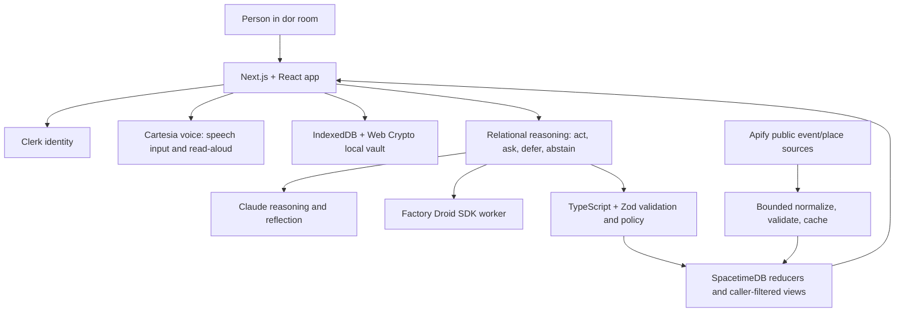

# dor

### Find your way back. Find your way in.

Life keeps opening new doors: a move, a new campus, a new job, a new beginning. The people you love can feel farther away, while the people around you are still strangers. As AI makes it easier to stay in a private loop with a screen, dor uses AI to help people take the next step toward each other.

**dor is a connection assistant for life's transitions: it helps you keep meaningful relationships close and find people and places to belong wherever you land.**

> Life will keep opening new doors. dor helps you find your way back—and your way in.

## Why dor

Transitions reshape daily routines, distance, and community all at once. Reaching out can feel awkward; walking into a new room alone can feel harder. dor uses voice and agentic AI to turn personal context into timely openings for real human connection. The AI helps create the moment. People make the connection.

## What dor does

### Keep existing relationships close

- **Voice notebook:** talk or type through a moment. Cartesia powers voice input and spoken follow-up questions; Claude can help reflect on what the user chooses to send for processing.
- **Automatic nudges:** accepted connections can receive an in-app nudge without the sender approving every instance. The reasoning layer can act, ask, defer, or do nothing; it considers timing, relationship context, conflict risk, and whether the moment should remain human-owned.
- **Relationship books:** keep selected photos and interaction notes—such as calls, introductions, and nudge feedback—in a private, encrypted local vault.
- **Responsible stops:** conflict or likely-friction context suppresses a nudge; serious distress surfaces support resources and does not contact a connection. dor does not send personal messages as the user.

### Find your way into a new community

- Set a transition, interests, and a one-time approximate area.
- Explore real local events and places from a server-side public catalogue.
- Discover eligible, opted-in profiles and potential introductions. The user chooses whether to reach out; the other person chooses whether to accept.
- Use event and profile recommendations without making journaling a requirement for discovery.

## One user journey

1. A person arrives somewhere new and completes a short, skippable onboarding.
2. They use the room's notebook to reflect by voice or text, or skip journaling entirely.
3. dor's reasoning layer evaluates whether to act, ask, defer, or abstain. For an accepted relationship, it may create a timely in-app nudge; for a new community, dor can surface a fitting event or eligible connection.
4. The person decides whether to take the next step. A real call, introduction, or shared activity happens between people.

## System architecture



**Data boundaries:** journal text is not copied into a connection's nudge or the public event catalogue. Apify receives a fixed public-source query, not a person's journal, private quiz answers, relationship IDs, attendance intent, or device-derived location. Selected reflection text may be processed by the configured AI provider when the user sends it for reflection. Relationship books use the local encrypted vault.

## Sponsor integrations

| Sponsor / track | What it contributes to dor | How it appears in the product |
|---|---|---|
| **Cartesia — Best Use of Cartesia** | Voice is a primary way to use the notebook, not a demo-only add-on. | Speech-to-text voice reflection and text-to-speech follow-up questions/read-aloud. The voice path is designed around a tap-to-talk, tap-to-stop interaction. |
| **Anthropic — Best Use of Claude** | Language understanding and reflection support. | Claude helps produce a relevant follow-up or structured reasoning input from the reflection the user chose to send. |
| **Factory — Best Use of the Droid SDK** | Triggered agent work in the running product. | The Droid SDK powers worker-side coordination; Backstage makes the agent activity and outcomes inspectable. |
| **Figma — Best Figma Workflow Hack** | Frontend planning and design-to-build workflow. | We planned each page in Figma with its purpose, component inventory, visual style, palette, and art direction, then used Figma's Cloud MCP. When MCP credits ran out, we continued the UI implementation in Claude Design. |
| **SpacetimeDB** | Authoritative shared state and real-time updates. | Reducers enforce state changes; caller-filtered views provide each account its permitted live state. |
| **Apify** | Public local discovery sources. | Pinned Actors retrieve event and place listings; dor normalizes, validates, caches, and ingests them into the catalogue. |
| **Meta — Bringing People Closer Together with AI** | The product's central goal. | AI is used to create openings for existing and new human relationships, with a working product flow rather than an AI-only social substitute. |

### Cartesia challenge fit

The voice experience is part of the core notebook flow: Cartesia handles spoken input and spoken follow-up, so the user can reflect without composing a long prompt. The demo should show one complete voice-to-connection journey, then briefly explain the problem and how the system was built. The implementation keeps a typed path available and does not make voice the only way to use dor.

The submission should include a working demo, a two-minute demo-first presentation, setup instructions, the Cartesia features used, known limitations, and source access for judges. The supplied Cartesia rubric weights problem/originality, Cartesia use, execution, and impact/responsibility equally (25% each).

### Other challenge fit

- **Meta:** show how AI meaningfully helps people reconnect or enter a new community; center originality and a strong working demo.
- **Factory:** Droid must do real triggered work in the running product. The Backstage surface helps make the agent's steps and outcomes visible; the worker is constrained to authorized inputs and guarded actions.
- **Anthropic:** Claude contributes to reflection and context-sensitive reasoning rather than serving as a generic chat wrapper.
- **Figma:** Figma was used before implementation to map pages, components, palette, style, and art direction, and through its Cloud MCP. After MCP credits ran out, the team moved the planned design into Claude Design to continue building the frontend.

## Live demo and evidence

- **Live room:** [live.doratcalhacks.site](https://live.doratcalhacks.site) during an active demo session.
- **Design walkthrough:** [doratcalhacks.site](https://doratcalhacks.site); this hosted tour uses clearly labeled sample data.
- **Event catalogue:** live Apify ingestion has been verified for Luma events, Google Maps places, and Google Events. The latest README status recorded 170 places and 51 events in Maincloud; refreshes are manual and use provider credits.
- **Notebook:** the live room has verified typed reflection and a real follow-up response. Check microphone capture and spoken playback on the actual presentation device before the demo.
- **Reasoning/Backstage:** the current app exposes the agent's decision path. Keep synthetic visual traces labeled as synthetic; do not present them as live provider or database telemetry.

The demo should show one complete user flow in two minutes: the transition problem, the notebook or discovery UI, the AI's useful contribution, and the resulting human action. Keep the explanation short and make the product visible.

## Built with

Next.js, React, TypeScript, Tailwind CSS, shadcn/ui, SpacetimeDB, Anthropic Claude, Factory Droid SDK, Cartesia, Apify, Clerk, Zod, IndexedDB, and the Web Crypto API.

## Run locally

Requirements: Node.js 20 or newer.

```sh
npm ci
cp .env.example .env.local
# Add local credentials and service configuration to .env.local
npm run dev
```

Never commit `.env.local`, provider keys, or real user data. See [.env.example](.env.example) for variable names and [docs/RUNBOOK.md](docs/RUNBOOK.md) for setup, demo, and reset details.

Useful checks:

```sh
npm run typecheck
npm run test:app
npm run build:app
```

## Known limitations

- New-profile discovery and the complete two-person introduction journey still need end-to-end verification with opted-in participants; demo fixtures must remain labeled.
- Apify catalogue refresh is manual, bounded, and uses credits. Live listings can change or be sparse in a chosen area.
- Verify voice capture and read-aloud on the exact phone or laptop used for judging.
- The agent visualization is explanatory. Only label a trace live when it is connected to real runtime events.
- No social-media scraping of personal accounts is part of the verified discovery pipeline.

## Team and repository ownership

| Person | Role | Main areas owned |
|---|---|---|
| **Rishi** | CS / product integration | App composition and navigation; Clerk and SpacetimeDB client/bindings; catalogue ingestion and Apify integration; deployment and release. Main paths: `src/app/`, `src/components/`, `src/lib/spacetime/`, `src/server/`, `scripts/ingest-catalogue.ts`. |
| **Nimisha** | DS / discovery quality | Candidate retrieval and ranking, matching evaluation, discovery cards and honest no-fit states. Main paths: `src/evaluation/`, `src/features/discovery/`. |
| **Adam** | AI / voice and worker | Cartesia and Claude adapters, Factory Droid SDK worker orchestration, bounded model calls, and provider efficiency. Main paths: `src/agents/`, `worker/`, voice/reflection API routes. |
| **Sumedh** | Cyber / privacy and policy | Vault, consent and authorization semantics, SpacetimeDB security guards/views, privacy controls, and adversarial checks. Main paths: `contracts/src/`, `spacetimedb/src/`, `src/privacy/`, `src/vault/`. |
| **Sumedh** | Relational reasoning | Decision policy and reasoning runtime: decide whether to act, ask, defer, or abstain, and define safe context and intervention boundaries. Main paths: `src/reasoning/core/`, `src/reasoning/runtime/`, reasoning specifications. |

Cross-role API and data contracts live in [`contracts/`](contracts/README.md). Read [`AGENTS.md`](AGENTS.md) before changing code; use [`INSTRUCTIONS.md`](INSTRUCTIONS.md) for the full architecture, project phases, and role handoffs. Continuous updates live in [`docs/updates/`](docs/updates/).

## Source access for judges

Provide judges access to this repository in accordance with Cal Hacks rules. Keep API keys and credentials out of the repository; use local `.env.local` or the hosting provider's secret store.

## More detail

- [Product and implementation guide](INSTRUCTIONS.md)
- [Project status and evidence ledger](PROJECT_KNOWLEDGE.md)
- [System plan](docs/PLAN.md)
- [Automatic nudges](docs/features/AUTOMATIC_NUDGES.md)
- [Live notebook](docs/features/LIVE_NOTEBOOK.md)
- [Reasoning architecture](docs/features/REASONING.md)
- [Apify sources and limits](docs/features/APIFY_SOURCES.md)
- [Demo and video plan](docs/DEMO.md)
