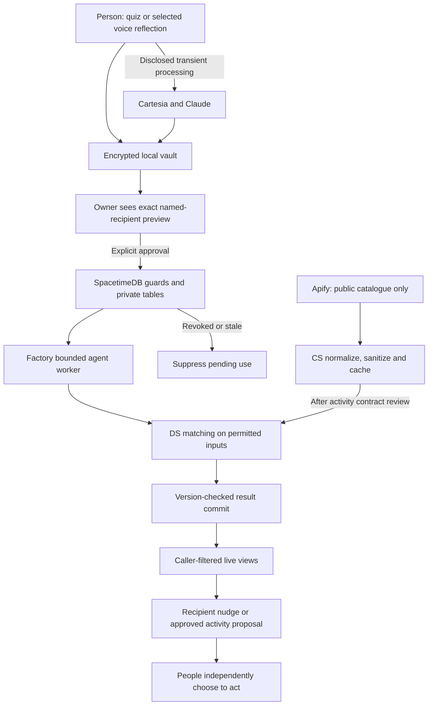

# Kinetic

### Private reflection that helps people turn intention into connection

Kinetic helps partners, friends and family living apart find a good moment and a concrete reason to connect. People reflect privately through voice; explicitly approved, minimal context lets their agents coordinate thoughtful suggestions. The new Apify discovery work adds real public activities so a suggestion can become a plan both people choose.

> The model proposes. People approve. Deterministic permissions decide what may cross the boundary.

## Start here
1. Read [AGENTS.md](AGENTS.md), [PRD.md](PRD.md) and [PROJECT_KNOWLEDGE.md](PROJECT_KNOWLEDGE.md).
2. Read [contracts/README.md](contracts/README.md) and its detailed specs. These are shared on main, never branch-private.
3. Find your detailed role guide: **[CS — you](docs/roles/cs.md)**, **[DS — Nimisha](docs/roles/ds.md)**, **[AI — Adam](docs/roles/ai.md)**, **[Cyber — Sumedh](docs/roles/cyber.md)**.
4. Read [shared dependencies and handoffs](docs/PLAN.md), your handoff and all role update logs. Preserve existing work; start at the first unmet phase gate.
5. Forward the tailored [team update messages](docs/team-messages/README.md) to agents that have already started.

## Why use it
A call is useful after people agree to show up. Kinetic addresses the missing context, timing and hesitation before that call. The intended loop is a private reflection → an exact approved signal → a useful suggestion → an optional shared activity proposal → two people deciding to act. Journaling must be useful on its own; suggestions should be specific enough to act on. Demand and usefulness remain hypotheses to test with real feedback, not proven retention claims.

| Relationship | Private owner context (never peer-visible) | Potential approved signal | Intended outcome |
|---|---|---|---|
| Partners | A difficult week away from home | Welcome a short call this week | A considerate check-in at a mutually suitable moment |
| Friends | Missing an old shared hobby | Explicitly approved activity interest after C7 review | An online activity both choose |
| Family | Wanting contact without a long catch-up | Welcome an encouraging note | A low-pressure connection chosen by the person |

Quiz answers personalize communication, support, social bandwidth and draft sharing preferences. The 6–8-question quiz is skippable. Partner/friend/family presets are explicitly confirmed and assigned; no per-person category overrides. Preset permission is only a ceiling: every shared item still needs named-recipient approval. Precise calendars, emotional causes, quiz labels and journal text do not become shared context automatically.

## Current implementation state — read before coding

This repository has active work; it is no longer just a planning scaffold. The inspected shared baseline is main through `c4315e3`. Status below separates code on main from branch-reported work; verify newer branch heads before relying on it.

| Component | Current evidence | Next owner/action |
|---|---|---|
| Next.js app, navigation, onboarding/connection/journal/privacy/nudge pages | CS M1 plus core flow draft merged; offline build/typecheck and unconfigured route smoke reported | CS: wire real adapters, complete live flow |
| SpacetimeDB private module and client adapter | CS M1 merged; 16 in-process module tests reported; generated bindings still placeholder in inspected handoff | CS: publish/generate and verify authenticated two-user path |
| Signal approval | Intentionally refuses until real privacy guard lands | Sumedh: implement exact guarded approval with CS |
| Local vault | Locked placeholder on inspected main | Sumedh: real VaultPort, keys/lock/profile/extras |
| AI providers/worker and AI-branch proposal contracts | Adam’s M1 adapters/worker and D021 proposal are merged via PR #4; consumer ACK/integration and full live verification remain pending | Adam: preserve work, request consumer review and integrate routes/real policy |
| Quiz semantics | Eight questions and D015 fixture fixes merged; review ACKs still needed | Nimisha: review/own mapping and rank/evaluation |
| Apify source/activity plans | Approved scope, documentation only; Actor/source and paid-run limits not selected | CS owns ingestion; Nimisha ranks; Adam coordinates; Sumedh guards |
| Production deployment / real end-to-end privacy | Not established by this documentation | All: publish reproducible live evidence before claims |

The AI branch’s reported timings are not full production evidence: its log notes missing Claude/Cartesia credentials and variable Droid latency. Never relabel an offline harness, fixture policy, placeholder or isolated provider call as the complete live application.

## Latest core-flow decisions to preserve
Main now includes [FLOWS.md](contracts/specs/FLOWS.md), `previewDisclosure`, `nudgeDelivery` and flow tests (CS draft of Sumedh-owned semantics; ACK pending). Main D016–D020 specify device-only preview, per-connection recipient opt-in default off, quiet hours 22:00–08:00 using the saved UTC offset, a 24-hour pair cooldown, no candidate for space/no need, and no nudge for availability-only approval. Draft helpers are not yet authoritative reducer wiring. Adam's branch also used the label D016 for a different proposal; reconcile by schema/commit, not the duplicate label.

## End-to-end system



SpacetimeDB holds authoritative relationships, consent/version state, approved signals and outcomes. Claude interprets selected disclosed context; Cartesia provides voice. Factory runs bounded coordination in a compatible worker. Apify supplies public activity data, not private reasoning or permissions. Detailed [architecture](contracts/specs/ARCHITECTURE.md) and [selected stack](docs/TECH_STACK.md) define the trust boundaries.

## Team ownership and exact boundaries

| Person | Owns implementation | Does not silently take over | Branch / detailed plan |
|---|---|---|---|
| **CS — you** | Product UI, identity, module/client wiring, deployment, public Apify source adapter/catalogue/cards | Vault cryptography, permission semantics, model services or rank logic | `role/cs-app` · [CS phases](docs/roles/cs.md) |
| **Nimisha — DS** | Quiz/profile mapping, matching, synthetic cases, quality/baseline evaluation | Source scraping, permission granting, other people’s private journals | `role/ds-context` · [DS phases](docs/roles/ds.md) |
| **Adam — AI** | Cartesia/Claude adapters, private reflection and voice loop, Factory worker and bounded proposal workflow | Consent authority, raw context in shared agents, source catalogue collection | `role/ai-voice` · [AI phases](docs/roles/ai.md) |
| **Sumedh — Cyber** | Encrypted local vault, policy semantics/guards, recipient/preset versioning, security tests and provider boundaries | Unclaimed module/UI edits, model-written authorization, fake privacy guarantees | `role/cyber-privacy` · [Cyber phases](docs/roles/cyber.md) |

CS owns module structure and generated bindings. Sumedh claims the precise approval/guard/suppression implementation files with CS. Adam claims provider route files with CS; session middleware and app wiring remain CS’s. Nimisha claims semantic changes to the existing quiz model with CS before editing. Shared wire shapes go in `@kinetic/contracts`; producer plus consuming owner review changes. This division keeps each person shipping code without making CS the sole implementer.

## Detailed 36-hour implementation phases

T+0 is the original agreed start. Planning takes only 30 minutes. These targets do not restart the clock or erase completed work. Each phase uses the same task IDs across all role guides. Gates require evidence, not a checked box; rotate short rest breaks and surface deadline risk early. Video production is deliberately separate in [docs/DEMO.md](docs/DEMO.md).

### P0 · T+0–0:30 — Align the one product and the interfaces

**Purpose:** Confirm the user journey, read current work, and let all four people code by minute 30.

| Owner / task | Concrete implementation |
|---|---|
| CS · `CS-P0` | Inspect merged shell/module; publish app adapter paths; claim Apify source integration. |
| Nimisha · `DS-P0` | Confirm quiz/profile mapping and three scenario expectations; identify rank inputs/outputs. |
| Adam · `AI-P0` | Inspect existing AI branch/AI-branch proposal; identify provider/worker interfaces needing review. |
| Sumedh · `CYBER-P0` | Define local vault and authoritative consent inputs; claim guard files with CS. |

**Exit evidence:** Every surface has one implementer, named consumers and an explicit private/shared boundary. No one repeats completed M1 work.

**If blocked:** If an interface is unresolved, record owner and deadline; continue on fixtures within owned modules.

### P1 · T+0:30–3 — Unblock teammates with working seams

**Purpose:** Resolve runtime uncertainty and publish usable fixtures/signatures early.

| Owner / task | Concrete implementation |
|---|---|
| CS · `CS-P1` | Prove account-to-module identity path, actual binding generation and environment needs. Select one Apify public source/Actor and document tested output/build/cost. |
| Nimisha · `DS-P1` | Deliver editable profile fixtures, preset examples and no-action cases; propose pure rank hook. |
| Adam · `AI-P1` | Reuse completed worker evidence; test missing Cartesia/Claude paths with credentials when available; document worker auth/deployment requirements. |
| Sumedh · `CYBER-P1` | Finalize key/unlock/recovery design; review existing guards/views and D015; publish vault/policy adapter requirements. |

**Exit evidence:** G1: all adapters have a signature, synthetic fixture and a consumer. Runtime/credential blockers are explicit. Public catalogue work contains no private user context.

**If blocked:** A failed provider spike gets a bounded follow-up while typed input and offline checks continue. Do not weaken identity or consent to meet the gate.

### P2 · T+3–7 — Build the private-to-approved path

**Purpose:** Make owner reflection and explicit sharing real before coordinating peers.

| Owner / task | Concrete implementation |
|---|---|
| CS · `CS-P2` | Wire quiz and vault into existing screens; finish invite acceptance, preset assignment, exact named preview, approve/decline and rejected-state UI. |
| Nimisha · `DS-P2` | Implement/review deterministic quiz mapping, initial rank logic and labeled 30-case dataset; treat skip/space as ordinary no-action outcomes. |
| Adam · `AI-P2` | Finish authenticated transient reflection/voice routes and browser mic/stop/cancel/error behavior; return private results only to the local vault. |
| Sumedh · `CYBER-P2` | Implement real VaultPort for journals/profiles/extras and guarded approval with exact payload/recipient/current versions/expiry/idempotency. |

**Exit evidence:** G2: selected text or voice becomes an owner-only reflection; only exact user-approved fields can be committed for a named recipient. Quiz completion/skip sends nothing.

**If blocked:** If vault or guard is missing, keep sharing disabled and record the exact missing artifact. No plaintext server journal or unconditional approval fallback.

### P3 · T+7–12 — Integrate a real two-person outcome

**Purpose:** Join the live interfaces rather than polishing independent islands.

| Owner / task | Concrete implementation |
|---|---|
| CS · `CS-P3` | Connect real module, approved-signal retrieval, caller-filtered subscriptions, work IDs and guarded worker-result commit. Build bounded Apify adapter/cache independently. |
| Nimisha · `DS-P3` | Integrate matching against approved signal/prefs; cover unsupported/missing/expired fields and normalized catalogue fixtures. |
| Adam · `AI-P3` | Run real bounded Factory coordination, rank hook, timeout/retry/no-action outcomes and pre-commit consent recheck; avoid duplicate results. |
| Sumedh · `CYBER-P3` | Validate direct reducer/subscription access, worker identity, third-user denial and revoke-during-generation; supply real policy adapter. |

**Exit evidence:** G3: two actual accounts complete journal → exact approval → bounded job → eligible nudge. A third account cannot see it; revoked or stale input cannot commit.

**If blocked:** If G3 slips, suspend stretch and focus each owner on their missing boundary. Apify data collection must not block the existing consent-to-nudge path.

### P4 · T+12–17 — Complete the product and all three relationships

**Purpose:** Make the flow understandable, controllable and useful in partners/friends/family cases.

| Owner / task | Concrete implementation |
|---|---|
| CS · `CS-P4` | Finish history, receipts, revoke/unlink and error screens. Show source-backed catalogue cards with format, timezone, source URL and fetch age. |
| Nimisha · `DS-P4` | Run each scenario end-to-end; compare initial rule baseline, no-fit and cold-start behavior; define allowed ranking explanation codes. |
| Adam · `AI-P4` | Handle support-only signals and recipient-preference consent correctly; return templates/no action rather than revealing hidden causes. |
| Sumedh · `CYBER-P4` | Complete deletion/derived revocation and preset-change invalidation; inspect provider logging and accurate privacy copy. |

**Exit evidence:** G4: all three seeded journeys work; what was shared is visible to the owner; catalogue items have provenance and unknown fields stay unknown.

**If blocked:** Fix a broken relationship case before introducing another scenario or feed. When no compatible action exists, suppress the nudge.

### P5 · T+17–22 — Measure quality and attack the boundaries

**Purpose:** Validate usefulness and failure recovery, not just a happy-path screenshot.

| Owner / task | Concrete implementation |
|---|---|
| CS · `CS-P5` | Exercise reload/reconnect/identity switch, provider failure, stale catalogue and empty states; fix integration defects. |
| Nimisha · `DS-P5` | Freeze and run 30 cases plus baseline; two teammates rate eligible suggestions. Report sample size, false nudges and actual usefulness. |
| Adam · `AI-P5` | Measure >=10 representative voice/nudge runs with median/p95 and timeouts; cap tools/rounds/retries; fix unsafe output. |
| Sumedh · `CYBER-P5` | Run injection, altered/encoded fields, wrong audience, stale versions, races, log leakage and direct database bypass cases. |

**Exit evidence:** G5: fixed deterministic privacy checks pass; quality and latency have measured results with limitations. Known privacy failures block real-user mode.

**If blocked:** The gate controls stretch, not truthful reporting. Fix the highest-impact diagnosed failure; never tune numbers or claim the latency target was achieved without measurements.

### P6 · T+22–27 — Turn discovery into a mutually accepted activity

**Purpose:** Finish the concrete differentiator using one reliable source and reviewed new sharing fields.

| Owner / task | Concrete implementation |
|---|---|
| CS · `CS-P6` | Finish Apify normalization/cache/source configuration and shared proposal UI/state. Ensure each participant accepts the same current proposal revision. |
| Nimisha · `DS-P6` | Rank approved activity interests and compatible time/format against valid catalogue records; provide clear permitted explanations. |
| Adam · `AI-P6` | Propose/counter within a bounded workflow using permitted activity context; humans accept, decline or cancel. |
| Sumedh · `CYBER-P6` | Review and enforce activity-specific consent categories, preset/assignment/item versions, audience, cancellation and expiry before shared delivery. |

**Exit evidence:** G6: one verified source-backed activity can become a plan both users independently accept; stale/revoked proposals cannot finalize.

**If blocked:** Current C3 does not authorize activity-interest fields. If C7/new consent review is incomplete, keep catalogue read-only and preserve the existing core path. No auto-booking or private data sent to Apify.

### P7 · T+27–31 — Stabilize one release candidate

**Purpose:** Stop expanding sources and make the integrated revision reproducible.

| Owner / task | Concrete implementation |
|---|---|
| CS · `CS-P7` | Freeze source/Actor configuration and build; fix blockers; document synthetic reset and deployment rollback. |
| Nimisha · `DS-P7` | Rerun frozen cases and baseline against the candidate; publish actual differences and remaining bad suggestions. |
| Adam · `AI-P7` | Exercise worker restart/replay, provider timeouts, limited credentials and cancellation; preserve honest fallback labels. |
| Sumedh · `CYBER-P7` | Review changed boundaries/config and retest revocation, membership and provider/source exposure. |

**Exit evidence:** G7: stable revision, reproducible run steps and agreed remaining limitations. Offline harness, isolated provider tests and real deployment evidence remain distinct.

**If blocked:** Only blocker fixes get new changes. Every boundary change triggers affected verification, not an indiscriminate rewrite.

### P8 · T+31–34 — Freeze, deploy and document

**Purpose:** Make the release understandable to someone outside the team.

| Owner / task | Concrete implementation |
|---|---|
| CS · `CS-P8` | Deploy the reviewed revision and run actual two-account smoke checks plus catalogue links/freshness; record configuration needs without secrets. |
| Nimisha · `DS-P8` | Publish final mappings, evaluation report, known coverage and repeatable commands. |
| Adam · `AI-P8` | Freeze tested prompts/model configuration and record deployed worker/provider status and actual timing. |
| Sumedh · `CYBER-P8` | Record final privacy acceptance, vault recovery/data-loss limitations, deletion semantics and unsupported claims. |

**Exit evidence:** A teammate can run the documented flow at the recorded revision; actual deployment behavior and unresolved issues are documented.

**If blocked:** No new broad features. If deployment fails, use the tested local/preview environment and state its limitation honestly.

### P9 · T+34–36 — Use the buffer for blockers and handoff

**Purpose:** Keep a stable product while completing release/submission support.

| Owner / task | Concrete implementation |
|---|---|
| CS · `CS-P9` | Handle release-blocking deployment/UI/source failures and verify the running revision. |
| Nimisha · `DS-P9` | Triage quality regressions and preserve frozen results. |
| Adam · `AI-P9` | Support critical provider/worker failures without increasing agent authority. |
| Sumedh · `CYBER-P9` | Review security-sensitive fixes and prevent emergency auth/privacy bypasses. |

**Exit evidence:** Final status, reproducible evidence and next owners are recorded. Planned work is not silently marked complete.

**If blocked:** Defer nonessential polish. Record incomplete integration rather than disguising synthetic behavior as live.

## Apify integration — what is new
CS owns the external public activity source and cards, not Nimisha or a separate fifth workstream. Start with one tested catalogue useful across distance. Collect generic public listings server-side, normalize and cache them, and let internal permitted matching choose useful options. Source freshness and provenance are visible; the catalogue can fail without breaking journaling.

No private journal, quiz answer, detailed schedule, pair identity or relationship label goes to Apify. New shared activity-interest/proposal fields require reviewed contracts/consent before use; the current support/availability signal is not a hidden transport for new data. See [the implementation plan and acceptance criteria](docs/features/ACTIVITY_DISCOVERY.md).

## Shared contracts and source of truth

| ID | Boundary | Producer → Consumer | Owner |
|---|---|---|---|
| C1 | Local profile/private reflection | Quiz/reflection → local vault/UI | Nimisha + Adam; Sumedh vault |
| C2 | Preset and named assignment | Owner confirmation → guarded state | Sumedh semantics; CS plumbing |
| C3 | ApprovedSignal v2 | Guarded approval → shared coordination | Sumedh; Adam consumes |
| C4 | ACK and bounded coordination | Consented prefs → outcome | Adam; Nimisha matching |
| C5 | Nudge and disclosure receipt | Guarded commit → own live view | CS; Sumedh review |
| C6 | Real policy port and offline test boundary | Authoritative guards → consumers | Sumedh; all consume |
| C7 (planned) | Public activity catalogue + shared proposal | CS source → rank/worker/UI | CS; Nimisha/Adam consume; Sumedh consent review |

The full [contract index](contracts/README.md) distinguishes executable schemas from planned interfaces. `contracts/src/schemas.ts` is the shared runtime schema source; generated schema files and fixtures change together. The app adapter seam is `src/lib/backend/ports.ts`; shared wire definitions must not fork there. Adam’s D021 additive contracts have now merged through PR #4; consumer/privacy ACKs and app/worker integration remain pending.

## Privacy and safety model
- Default deny; accepted connection plus confirmed preset plus named item approval plus current versions/expiry are required.
- Quiz completion and relationship labels do not grant access. Same-preset connections share category rules, but approvals remain recipient-specific.
- Journals/private extras persist in the encrypted local vault. Selected disclosed content may reach Cartesia/Claude; local persistence is not cloud-free processing.
- Factory only receives approved shared data. External source text cannot instruct the agent to call arbitrary tools or change permissions.
- Authorization is enforced inside authoritative reducers/views, not only Next.js/Zod or a model prompt. Workers cannot mint owner consent.
- Tightened presets, reassignment, unlink and revocation invalidate affected pending work and cached recipient state where feasible. Previously seen information cannot be recalled.
- No automatic messages, bookings, payments, group sharing, E2E inference claims or relationship diagnoses in the committed scope.

## Repository architecture

| Path | Purpose / owner |
|---|---|
| `src/app/`, `src/components/` | CS UI, shell and route integration; provider handlers claimed with Adam |
| `src/lib/backend/`, `src/lib/identity/`, `src/lib/spacetime/` | CS adapters/identity/bindings; consumed by all |
| `spacetimedb/` | CS module plumbing; Sumedh guard/approval review and coordinated implementation |
| `src/vault/`, `src/privacy/` | Sumedh encryption and real authorization semantics |
| `src/evaluation/` | Nimisha matching, evaluation and pure preference logic |
| `src/agents/`, `worker/` | Adam provider/worker code merged via PR #4; app/policy integration pending |
| `src/server/discovery/` | Planned CS Apify normalization/cache adapter |
| `contracts/` | Shared schemas/types/ports, generated schemas, specs, fixtures and checks |
| `integration/` | Cross-owner verification plan and future live smoke harnesses |
| `docs/roles/`, `docs/handoffs/`, `docs/updates/` | Detailed per-person phases, durable handoffs and ongoing logs |
| `docs/team-messages/` | Forwardable transition messages for agents already working |
| `PRD.md`, `PROJECT_KNOWLEDGE.md`, `docs/DECISIONS.md` | Requirements, durable actual status and decisions |

## Setup and verification
Use Node 20+ for supported packages; inspect package engines and current scripts. The existing app tests use Node’s TypeScript execution, so use the team-tested Node runtime (CS reported Node 24) or add an explicit compatible test runner before claiming support on an older runtime.

```sh
npm ci
npm run check          # shared contract schemas/fixtures/checks
npm run check:module   # in-process SpacetimeDB module harness, not live deployment
npm run typecheck
npm run test:app
npm run check:all      # the above checks together
npm run dev           # local Next.js app; missing adapters remain labeled
npm run build:app
```

Use `npm run contracts:schema` after runtime shape changes. `npm run build` currently builds contracts; it is not the application deployment command. Current scripts are authoritative; AI scripts `ai:build` and `ai:check` are now available after PR #4. Read bundled Next.js docs as AGENTS.md requires before coding against its APIs.

Copy configuration locally from [.env.example](.env.example); never commit credentials. Clerk and a correctly configured module identity mapping are needed for actual account checks. Publishing the SpacetimeDB module and generating bindings are separate from passing the in-process harness. Read [the module guide](spacetimedb/README.md) and [client guide](src/lib/spacetime/README.md). Never hand-write placeholder bindings and call them generated/live.

Apify requires a server-only token, selected Actor/source, build/input/output mapping, resource/cost bounds and tested dataset retrieval. No Actor run or paid resource was created by this documentation update. Factory needs its compatible deployed runtime and configured credentials; keys that work in a local CLI are not proof that a deployed worker is configured.

## Deployment responsibilities
CS coordinates Vercel app/API plus hosted SpacetimeDB, with Sumedh checking identities and views. Adam owns Factory-compatible worker deployment and provider adapter readiness. CS owns Apify ingestion deployment. Record URLs/revision and sanitized configuration requirements in handoffs; keep keys out of branch logs and shared screenshots.

## Evaluation and release claims
Nimisha owns 30 synthetic cases plus a rule baseline; Sumedh owns direct authorization/race checks; Adam owns measured provider/workflow timing; CS owns real two-account integration evidence. “No suggestion” is correct for paused preference, no overlap, missing consent or expired data. Report usefulness, latency, coverage and failure rates separately with actual sample counts. Existing isolated/fake-policy Droid runs do not prove full live privacy correctness.

## Team communication and syncing
Each person preserves their role branch and merges main into it. Never reset another person’s active branch to this documentation commit. Shared contracts stay on main. Use named task IDs from the phases, small PRs every 2–3 hours, logs on meaningful handoffs and consumer ACKs. Raise blocked interfaces within 15 minutes and inspect all four logs hourly. The [dependency plan](docs/PLAN.md) names exact artifacts/consumers and shared-file ownership.

## Scope and implementation honesty
Core: voice/typed reflection, local vault, explicit recipient-approved context, bounded coordination, useful nudge, privacy controls, three relationship instances. Added: one Apify catalogue and consent-reviewed shared-activity matching/proposal acceptance. Gate deeper activity delivery on reviewed new contracts and working core integration. Optional later: recurring rituals, additional sources and calendar OAuth. Group matching, automatic booking/payment and native apps remain out of this sprint unless explicitly reprioritized.

This setup takes its product/architecture/lifecycle/ownership/verification structure from [FaultLine](https://github.com/Jay-Thpr/FaultLine), adapted to Kinetic. It does not copy FaultLine runtime code or unrelated safety rules. Video planning stays in its own file. The repository remains private to invited collaborators; “shared contracts” means available to all four owners, not published personal data.

### Publication-time status update
While this plan was being written, Adam’s M1/D021 adapters and worker merged through PR #4 (main c4315e3). They are implemented/mostly offline-tested code, not yet the full configured app pipeline. Their runtime uses the restricted `droid exec` path; see worker/README.md for the SDK tradeoff and tested constraints. Nimisha and Sumedh also have active role-branch work; read those branches before assigning them new bootstrap work. Historical snapshots are evidence at their stated commit, not an instruction to rebuild. Main decision IDs D016–D021 remain intact; this planning scope uses D022–D025.
