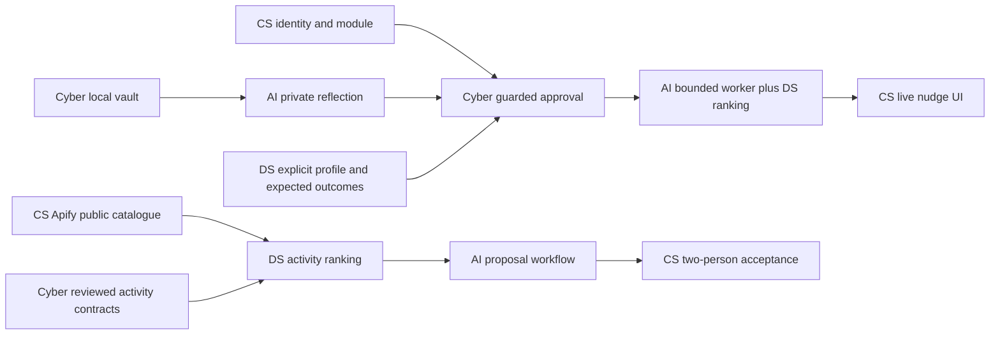

# Shared dependencies, integration gates and coordination

The detailed master phases are in [README.md](../README.md). Every person has a full phase plan with the same P0–P9 clock: [CS](roles/cs.md), [Nimisha/DS](roles/ds.md), [Adam/AI](roles/ai.md), [Sumedh/Cyber](roles/cyber.md). Times are relative to the original sprint start, not an instruction to restart completed work. Planning is only the first 30 minutes.

## Critical path

## Exactly who hands what to whom
| Producer | Artifact | Consumer | Required by | Consumer ACK |
|---|---|---|---|---|
| CS | Identity/caller mapping, module rows/views, app adapter ports | Sumedh, Adam | P1 | Can validate real caller and identify permitted data |
| Sumedh | VaultPort incl. profiles/extras; unlock/key behavior | CS | P2 | Existing UI saves/loads without plaintext fallback |
| Adam | Private reflection/voice adapter and reviewed response shape | CS, Sumedh | P2 | Authenticated route renders/persists only locally |
| Nimisha | Quiz/profile fixtures, no-action semantics | CS, Adam, Sumedh | P1/P2 | Skip/space/D015 handled consistently |
| Sumedh | Real policy guards and exact approval/version rules | CS, Adam | P2/P3 | Direct calls cannot bypass consent |
| CS | Guarded signal read, job store/claim/result API | Adam | P3 | Worker uses limited identity and cannot self-approve |
| Nimisha | Pure rank hook and expected outcomes | Adam | P2/P3 | Coordinator uses matching without private-state access |
| Adam | Bounded outcome, recheck, retry/cancel semantics | CS, Sumedh | P3 | Real result commits once under current consent |
| CS | Normalized Apify catalogue, stable IDs/freshness | Nimisha, Adam | P3/P4 | Missing/expired records handled explicitly |
| CS + Sumedh | Reviewed C7 proposal and new activity consent rules | Nimisha, Adam | Before P6 sharing | Schemas/fixtures/guards agreed; no C3 overloading |
| All | Three scenario traces and final verification | CS release integrator | P5/P7 | Current revision and evidence recorded |

## Shared-file edit ownership
- `src/lib/backend/ports.ts`: CS coordinates; Adam proposes reflection/voice additions; Sumedh proposes vault/policy additions. Shared wire types belong in contracts, not duplicate app-only definitions.
- `src/components/feature/quiz-model.ts`: starter by CS; Nimisha claims semantic changes with CS, who owns rendering.
- `spacetimedb/src/schema.ts`, module exports and client bindings: CS coordinates. Sumedh claims approval/guard/suppression tests and files; neither edits another claimed file concurrently.
- `src/app/api/reflections/` and voice route: Adam owns provider handler after file claim; CS supplies identity/session wiring. Both review logging and token exposure with Sumedh.
- `src/server/discovery/` and discovery route: CS owns; Nimisha defines consumed fields; Sumedh reviews inputs/source handling.
- Contracts: producer plus affected consumer review, and Sumedh for privacy. AI-branch proposal on Adam’s branch remains a proposal until reviewed/merged.

## Shared acceptance gates
- **G1, P1 end:** every adapter has a consumer-facing signature/fixture and an owner; runtime/credential blockers logged.
- **G2, P2 end:** private journal/reflection and exact named approval work with real guards; no sharing from skipped quiz.
- **G3, P3 end:** deployed two-account flow reaches a nudge using a real bounded worker; wrong/expired/revoked input denied.
- **G4, P4 end:** partners/friends/family all work and receipts show only approved fields; catalogue source returns clean records independently.
- **G5, P5 end:** fixed privacy cases pass, quality results are measured, failure paths work. This gate controls stretch; it does not waive known failures.
- **G6, P6 end:** source-backed activity proposal can be accepted by both users only if reviewed activity contracts/guards landed; otherwise catalogue remains read-only and core path stays intact.
- **G7, P7/P8:** stable revision, real deployment smoke evidence, source/provider limitations and rollback documented.

## If a dependency slips
Work on independent tests/UI with explicit fixtures; record what remains non-live. If core integration misses P3, cancel stretch and focus all owners on their specific missing boundary. Apify failure must not block journaling, consent or existing nudges. New activity sharing waits for contract/guard review; show catalogue only rather than bypassing permission. Provider failure offers typed entry or no suggestion, never fabricated live output. Known privacy failure blocks real-user mode.

## Communication and safe syncing
Use task IDs CS-P#, DS-P#, AI-P#, CYBER-P#. Each meaningful handoff includes branch/commit, files/contracts, evidence, next named consumer action and blocker. Consumers ACK usable handoffs; shared dashboard is for cross-role next actions. Read logs hourly, raise blockers within 15 minutes, hold at most a short handoff every 3 hours.

Fetch and merge origin/main into your role branch; preserve local work and resolve conflicts with the relevant owner. Do not reset/force-update another person’s branch or overwrite their handoff history. This planning update is pushed to main; active roles consume it by merging main themselves. Small role PRs reach main every 2–3 hours. Video planning stays separate in docs/DEMO.md.
